<p align="center"></p>
<p align="center"></p>

<p align="center">
  <a href="https://callmekaue.github.io/modelagem-difeecult/"></a>
  
  
  
  
  
  
  
</p>

<p align="center">
  
  
  
  
  
</p>

<p align="center">
  <b>ERP feito sob medida para a DifeeCult, marca de moda automotiva.</b><br>
  Vendas no PDV, estoque por cor e tamanho, eventos, formação de preço, financeiro, funcionários e auditoria,<br>
  tudo em um banco de dados único e modelado do zero.
</p>

<p align="center"></p>

<h2 align="center">Veja em 38 segundos</h2>

<table>
<tr>
<td width="300" align="center">
  <a href="difeecult-readme-arquivos/anuncio/anuncio-difeecult.mp4"></a><br>
  <sub>Clique para assistir com som</sub>
</td>
<td>

**"Imagina ter 9 anos de empresa e não saber quanto faturou nos 4 primeiros anos."**

Era assim na DifeeCult: venda anotada no caderno, estoque contado no olho e evento sem saber se deu lucro.
O vídeo mostra como o ERP resolve isso, com as telas reais do sistema:

- venda em segundos no Pix, débito ou crédito parcelado
- estoque que baixa sozinho e avisa antes de acabar
- evento com estoque próprio e a conta de se valeu a pena
- cada parcela do cartão no dia em que cai na conta
- o placar do mês em tempo real

[Assistir ao vídeo completo](difeecult-readme-arquivos/anuncio/anuncio-difeecult.mp4)

</td>
</tr>
</table>

<p align="center"></p>

<h2 align="center">Teste agora</h2>

<table>
<tr>
<td width="260" align="center">
  <a href="https://callmekaue.github.io/modelagem-difeecult/"></a><br>
  <sub>Aponte a câmera do celular</sub>
</td>
<td>

**Acesse:** [https://callmekaue.github.io/modelagem-difeecult/](https://callmekaue.github.io/modelagem-difeecult/)

**Usuário:** `teste` &nbsp;&nbsp; **Senha:** `teste123`
(ou clique em **"Entrar como Teste (vendedor)"** na tela de login)

A demonstração roda o servidor do ERP **dentro do seu navegador**, com o banco de dados da apresentação. Pode vender, cadastrar e apagar à vontade: os dados ficam salvos só no seu navegador. O botão **Restaurar dados**, no selo **DEMO**, volta tudo ao original.

</td>
</tr>
</table>

<p align="center"></p>

<h2 align="center">Sumário</h2>

<table align="center">
<tr><td><a href="#s1"><b>01</b> &nbsp;A empresa</a><br><sub>Moda feita para quem vive o carro</sub></td><td><a href="#s2"><b>02</b> &nbsp;As dores</a><br><sub>O que travava a operação antes do ERP</sub></td><td><a href="#s3"><b>03</b> &nbsp;A solução</a><br><sub>Um sistema, um banco, uma operação</sub></td></tr>
<tr><td><a href="#s4"><b>04</b> &nbsp;Em movimento</a><br><sub>O sistema funcionando de verdade</sub></td><td><a href="#s5"><b>05</b> &nbsp;Módulos e telas</a><br><sub>Comercial, financeiro, cadastros e administrativo</sub></td><td><a href="#s6"><b>06</b> &nbsp;Modelagem</a><br><sub>Visão geral: 34 tabelas em 7 domínios</sub></td></tr>
<tr><td><a href="#s7"><b>07</b> &nbsp;Por domínio</a><br><sub>Cada recorte do DER com as regras de negócio</sub></td><td><a href="#s8"><b>08</b> &nbsp;Integridade</a><br><sub>PK, FK, UNIQUE, CHECK e transações</sub></td><td><a href="#s9"><b>09</b> &nbsp;Decisões</a><br><sub>Por que o modelo é do jeito que é</sub></td></tr>
<tr><td><a href="#s10"><b>10</b> &nbsp;Dicionário de dados</a><br><sub>As 34 tabelas e 328 colunas, uma a uma</sub></td><td><a href="#s11"><b>11</b> &nbsp;Arquitetura</a><br><sub>Navegador, API Express e banco</sub></td><td><a href="#s12"><b>12</b> &nbsp;Permissões</a><br><sub>Quem pode ver e quem pode editar</sub></td></tr>
<tr><td><a href="#s13"><b>13</b> &nbsp;Como rodar</a><br><sub>Do npm install ao sistema no ar</sub></td><td><a href="#s14"><b>14</b> &nbsp;Demo online</a><br><sub>O servidor rodando dentro do navegador</sub></td><td><a href="#s15"><b>15</b> &nbsp;Estrutura</a><br><sub>Os arquivos do projeto</sub></td></tr>
<tr><td><a href="#s16"><b>16</b> &nbsp;Testes</a><br><sub>214 testes automatizados</sub></td><td><a href="#s17"><b>17</b> &nbsp;Próximos passos</a><br><sub>Para onde o DifeeCult ERP pode acelerar</sub></td></tr>
</table>

<p align="center"></p>

<a name="s1"></a>
<p align="center"></p>


A **DifeeCult** é uma marca de moda automotiva: roupas e acessórios com artes próprias inspiradas na cultura dos carros, de clássicos JDM a europeus.

- **Portfólio:** camisetas casuais e oversized, moletons, bonés, chaveiros e aromatizantes.
- **Onde vende:** principalmente em eventos automotivos, de **3 a 4 por mês**: JDM, The Kings, Festival de Interlagos.
- **Público:** entusiastas de carros, drift e eventos automotivos, que compram por paixão, no calor do evento.
- **Diferenciais:** tecidos e estampas de qualidade, modelos exclusivos e preços atrativos.

Como cada evento é venda, vitrine e logística ao mesmo tempo, **estoque, venda e custo precisam estar ligados ao evento**. Essa é a ideia central do modelo de dados.

<br clear="right">

<a name="s2"></a>
<p align="center"></p>

| Área | Como era antes do ERP |
|---|---|
| **Pós-evento** | Mais de **4 dias** conferindo o estoque peça por peça depois de cada evento. Com 3 a 4 eventos por mês, quase metade do mês ia em contagem. |
| **Vendas** | A maquininha mostra só o valor; produto, cor, tamanho e quantidade dependiam de anotação. |
| **Durante o evento** | Sem baixa em tempo real: ninguém sabia o que ainda estava disponível. |
| **Finanças** | Dinheiro pessoal e da empresa misturados; o resultado real ficava impreciso. |
| **Eventos** | Transporte, alimentação, hospedagem e taxas não se ligavam ao que foi vendido. |
| **Produção** | Pouco controle de fornecedores e do custo real de cada peça. |
| **Processos** | Planilhas + anotações + WhatsApp = retrabalho e números que não batem. |

<a name="s3"></a>
<p align="center"></p>

Um **ERP próprio**, com **um único banco de dados** que integra todos os setores:

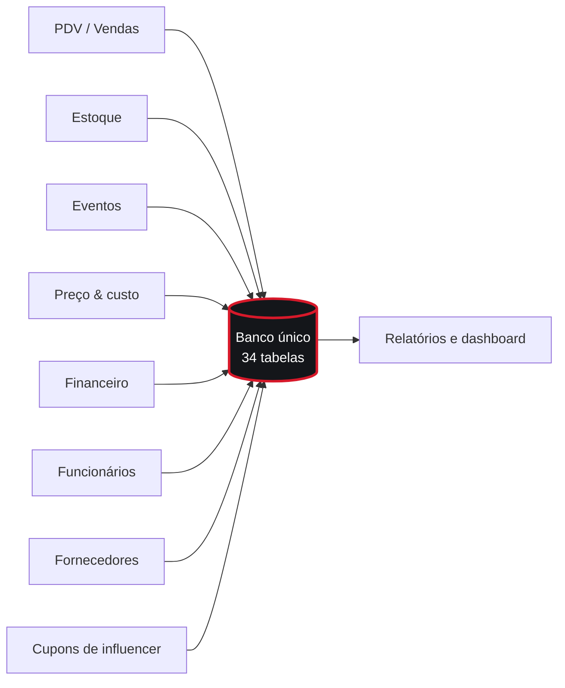

- **Fonte única de dados:** todos consultam a mesma informação, da loja ao evento.
- **Módulos integrados:** a venda dá baixa no estoque, lança no caixa e entra no relatório do evento sozinha.
- **Registrou uma vez, vale para todos:** menos digitação, menos erro, menos WhatsApp.

| Hoje | Com o ERP | Onde está no banco |
|---|---|---|
| Mais de 4 dias de contagem manual | Saldo por produto, cor e tamanho na hora | `produtos`, `movimentacao_estoque` |
| Só o valor das transações | Produto, tamanho e quantidade em cada venda | `vendas`, `venda_item` |
| Preço "no olho" | Custo da peça e preço sugerido com lucro real | `ficha_custo`, `ficha_custo_item` |
| Pessoal e empresa misturados | Caixa, contas e fornecedores num só lugar | `caixa`, `contas`, `contas_receber` |
| Evento sem conta fechada | Vendas e saídas ligadas ao evento | `eventos` ← `vendas.evento_id` |

<p align="center"></p>

<a name="s4"></a>
<p align="center"></p>

<h3>Venda no PDV: produto, variação, pagamento e confirmação</h3>
<p align="center"></p>

<h3>Tour pelas telas</h3>
<p align="center"></p>

<h3>Ficha de custo: o preço sugerido muda enquanto você digita</h3>
<p align="center"></p>

<table>
<tr>
<td width="40%" align="center"></td>
<td>
<h3>Feito para o celular também</h3>
No evento, o PDV roda no celular: barra inferior com Início, Vender, Caixa e Estoque, botões grandes e vitrine com foto. Tem tema escuro (padrão) e tema claro.
</td>
</tr>
</table>

<p align="center"></p>

<a name="s5"></a>
<p align="center"></p>

### Comercial

**Dashboard.** Placar do mês, vendas, ticket médio, brindes e canceladas, vendas do dia e atalhos.

**Vendas (PDV).** Vitrine com fotos e categorias, grade de cor × tamanho, CPF na nota, brinde a partir de 3 peças, cupom de influencer, desconto em % ou R$ e **pagamento diversificado** (até 5 formas numa venda só). Antes de finalizar, uma tela de confirmação.

<table>
<tr><td width="50%" valign="top"><br><sub><b>PDV: vitrine com foto e venda atual</b></sub></td><td width="50%" valign="top"><br><sub><b>Grade de cor e tamanho do modelo</b></sub></td></tr>
<tr><td width="50%" valign="top"><br><sub><b>Pagamento diversificado: várias formas numa venda</b></sub></td><td width="50%" valign="top"><br><sub><b>Dashboard: placar do mês</b></sub></td></tr>
</table>

**Caixa.** Entradas do dia por forma de pagamento, confirmação de cartão e cancelamento de venda (com motivo; a venda nunca é apagada).

**Produtos & Estoque.** Modelos com variações de cor e tamanho, peças únicas, categorias e cores editáveis, entrada em lote e histórico de movimentações.

**Preço & custo.** Ficha de custo de cada modelo (tecido, corte, costura, estampa...), preço sugerido pelo markup divisor, margem real do preço atual e filtros de prejuízo e abaixo da meta.

<table>
<tr><td width="50%" valign="top"><br><sub><b>Caixa</b></sub></td><td width="50%" valign="top"><br><sub><b>Produtos & Estoque</b></sub></td></tr>
<tr><td width="50%" valign="top"><br><sub><b>Categorias de produto editáveis</b></sub></td><td width="50%" valign="top"><br><sub><b>Preço & custo: margem de cada peça</b></sub></td></tr>
<tr><td width="50%" valign="top"><br><sub><b>Ficha de custo com prévia ao vivo</b></sub></td><td width="50%" valign="top"><br><sub><b>Movimentar: entradas, doações e brindes</b></sub></td></tr>
</table>

**Eventos.** Calendário, próximos eventos, tipos com cor, eventos anuais que se repetem sozinhos e o resultado de vendas de cada evento.

**Relatórios.** Saídas e vendas, posição de estoque, contagem do caixa e vendas por evento, prontos para imprimir ou salvar em PDF.

<table>
<tr><td width="50%" valign="top"><br><sub><b>Eventos: calendário e próximos</b></sub></td><td width="50%" valign="top"><br><sub><b>Relatórios em PDF</b></sub></td></tr>
<tr><td width="50%" valign="top"><br><sub><b>Quadro de avisos</b></sub></td><td width="50%" valign="top"><br><sub><b>Cupons de influencer</b></sub></td></tr>
</table>

### Financeiro

**Contas a pagar e a receber.** Vencidas, vencendo, próximos 7 dias, dívidas fixas que geram a conta todo mês, ligação com fornecedor e com a venda.

<table>
<tr><td width="50%" valign="top"><br><sub><b>Contas a pagar</b></sub></td><td width="50%" valign="top"><br><sub><b>Contas a receber</b></sub></td></tr>
</table>

### Cadastros e administrativo

**Funcionários.** CLT e PJ, telefones e e-mails múltiplos, endereço, banco, benefícios, holerite (CLT) e recibo (PJ) com INSS, IRRF, FGTS e retenções. **Usuários e acessos** com permissão por tela, **Log de atividades** e **Parâmetros** do sistema.

<table>
<tr><td width="50%" valign="top"><br><sub><b>Funcionários CLT e PJ</b></sub></td><td width="50%" valign="top"><br><sub><b>Usuários e acessos</b></sub></td></tr>
<tr><td width="50%" valign="top"><br><sub><b>Log de atividades</b></sub></td><td width="50%" valign="top"><br><sub><b>Parâmetros do sistema</b></sub></td></tr>
</table>

### Tema claro e celular

<table>
<tr><td width="50%" valign="top"><br><sub><b>Tema claro: dashboard</b></sub></td><td width="50%" valign="top"><br><sub><b>Tema claro: preço & custo</b></sub></td></tr>
</table>

<table>
<tr>
<td align="center"><br><sub><b>Dashboard</b></sub></td>
<td align="center"><br><sub><b>PDV</b></sub></td>
<td align="center"><br><sub><b>Estoque</b></sub></td>
<td align="center"><br><sub><b>Preço & custo</b></sub></td>
</tr>
</table>

<p align="center"></p>

<a name="s6"></a>
<p align="center"></p>

<p align="center"></p>

### Do requisito ao banco

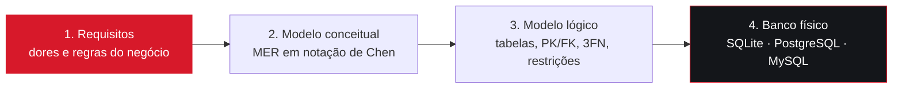

O mesmo modelo existe em três bancos: **SQLite** (uso local, criado pelo próprio servidor), **PostgreSQL no Supabase** (nuvem, 32 migrações em `supabase/migrations`) e **MySQL** (script único `banco_mysql.sql`, de onde vêm os diagramas e o dicionário abaixo).

### Os 7 domínios

| Domínio | Tabelas | Para quê |
|---|---|---|
| **Catálogo e estoque** (6) | `modelos` `produtos` `categoria_produto` `cor` `foto` `movimentacao_estoque` | O que a loja vende e quanto tem de cada peça |
| **Vendas e pagamentos** (7) | `vendas` `venda_item` `caixa` `pagamentos` `pagamento_historico` `vendas_canceladas` `descontos` | Cada venda, como foi paga e o que foi cancelado |
| **Eventos** (3) | `eventos` `eventos_anuais` `tipo_evento` | A agenda e a conta de cada evento |
| **Preço & custo** (2) | `ficha_custo` `ficha_custo_item` | Quanto custa fazer cada peça e por quanto vender |
| **Fornecedores e financeiro** (6) | `fornecedor` `fornecedor_telefone` `fornecedor_email` `contas` `contas_fixas` `contas_receber` | Quem fornece, o que pagar e o que receber |
| **Pessoas e folha** (6) | `funcionario` `funcionario_telefone` `funcionario_email` `holerite` `empresa` `clt_tabela` | Equipe, holerites e recibos |
| **Acesso e sistema** (4) | `usuarios_erp` `usuario_permissao` `log_atividade` `parametros` | Quem entra, o que pode fazer e o que foi feito |

### MER conceitual (notação de Chen)

Antes das tabelas vem o modelo conceitual: o que existe no negócio e como as coisas se ligam, sem pensar ainda em chave estrangeira. São **28 entidades** e **33 relacionamentos**, desenhados na notação de Chen com cardinalidade (mín,máx). Clique para abrir em tamanho real ([versão SVG](difeecult-readme-arquivos/mer/mer-geral.svg)).

<p align="center"></p>

<p align="center">
  <a href="difeecult-readme-arquivos/mer/mer-geral.png"></a>
</p>

<sub>No MER geral cada entidade aparece só com o identificador, para caber tudo. Os atributos completos estão nos MERs de cada domínio, na seção 7.</sub>

**Como se lê a cardinalidade.** O par (mín,máx) fica do lado da entidade e diz quantas ocorrências dela se ligam a **uma** ocorrência da outra ponta. Exemplo: `Venda (0,N) — realiza — (0,1) Usuário` quer dizer que um usuário realiza nenhuma ou muitas vendas, e cada venda é feita por no máximo um usuário.

**Do conceitual (28 entidades) ao lógico (34 tabelas).** As 6 tabelas a mais não são entidades novas, são consequência das regras de mapeamento:

| No MER (Chen) | Vira no banco | Por quê |
|---|---|---|
| Atributo multivalorado **telefones** e **e-mails** de Fornecedor | `fornecedor_telefone`, `fornecedor_email` | 1FN: uma coluna não guarda lista, então cada valor vira uma linha |
| Atributo multivalorado **telefones** e **e-mails** de Funcionário | `funcionario_telefone`, `funcionario_email` | Mesma regra |
| Atributo multivalorado **permissões** de Usuário | `usuario_permissao` (PK composta usuário + tela) | Cada tela liberada é uma linha, com o nível de acesso |
| Relacionamento N:N **contém** (Venda × Produto) com atributos tipo, quantidade e preço unitário | `venda_item` | N:N sempre vira tabela associativa, e os atributos do relacionamento vão junto |
| Entidades fracas **Item de custo** e **Histórico de pagamento** | `ficha_custo_item`, `pagamento_historico` | Só existem dentro do dono; a FK do dono faz parte da identificação e apaga em cascata |
| Atributos compostos (endereço, dados bancários, transação...) | Uma coluna para cada parte | Atributo composto se achata nas colunas simples |

### DER completo

Todas as 34 tabelas, todas as 328 colunas e todas as 46 ligações, agrupadas por domínio. Clique para abrir em tamanho real ([versão SVG](difeecult-readme-arquivos/modelagem/der-completo.svg), que dá para ampliar sem perder qualidade).

<p align="center">
  <a href="difeecult-readme-arquivos/modelagem/der-completo.png"></a>
</p>

<sub>Legenda: <b>PK</b> chave primária · <b>FK</b> chave estrangeira · <b>UQ</b> valor único · <b>*</b> obrigatório (NOT NULL) · pé de galinha = "muitos" · traço = "um" · bolinha = "opcional".</sub>

### Diagrama ER interativo (modelagem inteira)

O GitHub desenha o diagrama abaixo direto do código: dá para dar zoom e arrastar. São as 34 tabelas com todas as colunas e cardinalidades.

```mermaid
erDiagram
    categoria_produto {
        bigint id PK
        varchar nome UK
        datetime criado_em
    }
    cor {
        bigint id_cor PK
        varchar nome UK
    }
    foto {
        bigint id_foto PK
        varchar tipo_mime
        blob dados
        int tamanho
        datetime criada_em
    }
    modelos {
        bigint id PK
        varchar nome
        varchar categoria FK
        decimal preco
        datetime criado_em
        bigint id_foto FK
    }
    produtos {
        bigint id PK
        varchar nome
        varchar categoria FK
        decimal preco
        int estoque
        boolean ativo
        bigint modelo_id FK
        varchar cor
        varchar tamanho
        bigint id_foto FK
    }
    movimentacao_estoque {
        bigint id PK
        bigint produto_id FK
        varchar tipo
        int quantidade
        bigint venda_id FK
        bigint criado_por FK
        varchar destino
        varchar observacao
        bigint evento_id FK
        datetime criado_em
    }
    descontos {
        bigint id PK
        varchar nome
        varchar codigo UK
        decimal percentual
        decimal comissao_percentual
        varchar status
        date data_inicio
        date validade
        datetime criado_em
    }
    vendas {
        bigint id PK
        decimal total
        varchar forma_pagamento
        date data_venda
        decimal subtotal
        bigint desconto_id FK
        varchar desconto_codigo
        decimal desconto_percentual
        decimal desconto_valor
        varchar status_pagamento
        int parcelas
        varchar forma_pagamento_detalhe
        char cpf_nota
        bigint usuario_id FK
        bigint evento_id FK
        datetime criado_em
    }
    venda_item {
        bigint id PK
        bigint venda_id FK
        bigint produto_id FK
        varchar tipo
        int quantidade
        decimal preco_unitario
        bigint brinde_venda_id UK
    }
    caixa {
        bigint id PK
        bigint venda_id FK
        decimal valor
        varchar forma_pagamento
        date data_pagamento
        varchar status
    }
    pagamentos {
        bigint id PK
        bigint venda_id FK
        varchar provedor
        varchar chave_idempotencia UK
        varchar estado
        decimal valor
        varchar resultado_codigo
        varchar mensagem
        datetime criado_em
        datetime atualizado_em
        varchar adquirente
        varchar maquina_identificacao
        varchar nsu
        varchar codigo_autorizacao
        decimal valor_aprovado
        datetime aprovado_em
        bigint confirmado_por FK
        datetime confirmado_em
        varchar observacoes
        varchar estado_repasse
    }
    pagamento_historico {
        bigint id PK
        bigint pagamento_id FK
        varchar estado_anterior
        varchar estado_novo
        bigint operador_id FK
        varchar observacao
        datetime criado_em
    }
    vendas_canceladas {
        bigint id PK
        bigint venda_id UK
        bigint produto_id FK
        varchar produto_nome
        varchar cliente
        char cpf_nota
        int quantidade
        decimal subtotal
        varchar desconto_codigo
        decimal desconto_valor
        decimal total
        varchar forma_pagamento
        date data_venda
        varchar status_pagamento_anterior
        decimal valor_estornado_caixa
        boolean estoque_devolvido
        varchar motivo
        bigint cancelado_por FK
        datetime cancelado_em
        bigint evento_id FK
    }
    tipo_evento {
        bigint id PK
        varchar chave UK
        varchar nome UK
        char cor
        datetime criado_em
    }
    eventos {
        bigint id PK
        date data
        date data_fim
        char hora_inicio
        char hora_fim
        varchar local
        varchar tipo FK
        varchar titulo
        varchar descricao
        bigint criado_por FK
        datetime criado_em
        bigint anual_id FK
        int ano_ocorrencia
    }
    eventos_anuais {
        bigint id PK
        varchar titulo
        varchar descricao
        tinyint mes
        tinyint dia
        int gerado_ate_ano
        boolean ativo
        int duracao_dias
        char hora_inicio
        char hora_fim
        varchar local
        varchar tipo FK
        bigint criado_por FK
        datetime criado_em
    }
    ficha_custo {
        bigint id PK
        bigint modelo_id FK, UK
        bigint produto_id FK, UK
        decimal imposto_pct
        decimal taxa_pct
        decimal comissao_pct
        decimal despesas_pct
        decimal margem_pct
        varchar arredondamento
        varchar observacoes
        bigint atualizado_por FK
        datetime atualizado_em
    }
    ficha_custo_item {
        bigint id PK
        bigint ficha_id FK
        int ordem
        varchar etapa
        varchar descricao
        decimal quantidade
        varchar unidade
        decimal valor_unitario
        decimal rendimento
    }
    fornecedor {
        bigint id_fornecedor PK
        varchar razao_social
        varchar nome_fantasia
        char cnpj UK
        varchar tipo
        boolean ativo
    }
    fornecedor_telefone {
        bigint id_fornecedor PK, FK
        int id_telefone PK
        varchar codigo_pais
        varchar ddd
        varchar numero
    }
    fornecedor_email {
        bigint id_fornecedor PK, FK
        int id_email PK
        varchar email UK
    }
    contas {
        bigint id PK
        varchar descricao
        decimal valor
        date vencimento
        varchar status
        bigint conta_fixa_id FK
        varchar competencia
        bigint id_fornecedor FK
        varchar categoria
        varchar observacoes
        date data_pagamento
        varchar forma_pagamento
    }
    contas_fixas {
        bigint id PK
        varchar descricao
        decimal valor
        tinyint dia_vencimento
        varchar primeiro_mes
        varchar gerada_ate
        boolean ativa
        date encerrada_em
        bigint criado_por FK
        datetime criado_em
        bigint id_fornecedor FK
        varchar categoria
    }
    contas_receber {
        bigint id PK
        varchar descricao
        varchar categoria
        varchar relacionado
        decimal valor
        date vencimento
        date data_recebimento
        varchar status
        varchar forma_recebimento
        varchar observacoes
        bigint venda_id FK, UK
    }
    funcionario {
        bigint id PK
        varchar tipo_vinculo
        varchar nome_completo
        char cpf UK
        varchar rg
        date data_nascimento
        varchar estado_civil
        char pis
        varchar ctps
        char cnpj UK
        varchar razao_social
        varchar cargo
        varchar cbo
        varchar departamento
        date data_admissao
        date data_desligamento
        int jornada_semanal
        decimal salario_bruto
        int dependentes_irrf
        decimal pensao_alimenticia
        boolean recebe_vt
        boolean descontar_vt
        decimal vt_valor_diario
        int vt_dias_uteis
        decimal alimentacao_valor
        decimal alimentacao_desconto_percentual
        decimal outros_descontos
        varchar outros_descontos_descricao
        decimal pj_irrf_percentual
        decimal pj_csrf_percentual
        decimal pj_iss_percentual
        char cep
        varchar logradouro
        varchar numero
        varchar complemento
        varchar bairro
        varchar cidade
        char uf
        varchar banco
        varchar agencia
        varchar conta_bancaria
        varchar tipo_conta
        varchar chave_pix
        varchar emergencia_nome
        varchar emergencia_parentesco
        varchar emergencia_telefone
        varchar observacoes
        boolean ativo
        datetime criado_em
    }
    funcionario_telefone {
        bigint id_funcionario PK, FK
        int id_telefone PK
        varchar tipo
        varchar codigo_pais
        varchar ddd
        varchar numero
    }
    funcionario_email {
        bigint id_funcionario PK, FK
        int id_email PK
        varchar tipo
        varchar email
    }
    holerite {
        bigint id PK
        bigint funcionario_id FK
        char competencia
        varchar tipo_vinculo
        json variaveis
        json dados
        decimal total_proventos
        decimal total_descontos
        decimal liquido
        bigint conta_id FK
        bigint gerado_por FK
        datetime gerado_em
    }
    empresa {
        int id PK
        varchar razao_social
        varchar nome_fantasia
        varchar cnpj
        varchar endereco
        varchar cidade
        char uf
        varchar telefone
        varchar email
        datetime atualizado_em
    }
    clt_tabela {
        int ano PK
        json dados
        bigint atualizado_por FK
        datetime atualizado_em
    }
    usuarios_erp {
        bigint id PK
        varchar nome
        varchar departamento
        varchar login UK
        varchar senha
    }
    usuario_permissao {
        bigint usuario_id PK, FK
        varchar tela PK
        boolean pode_editar
    }
    log_atividade {
        bigint id PK
        datetime criado_em
        bigint usuario_id
        varchar usuario_nome
        varchar acao
        varchar descricao
        decimal valor
        bigint venda_id
    }
    parametros {
        varchar chave PK
        varchar valor
        bigint atualizado_por FK
        datetime atualizado_em
    }
    foto |o--o{ modelos : "id_foto"
    categoria_produto ||--o{ modelos : "categoria"
    modelos |o--o{ produtos : "modelo_id"
    foto |o--o{ produtos : "id_foto"
    categoria_produto ||--o{ produtos : "categoria"
    produtos ||--o{ movimentacao_estoque : "produto_id"
    vendas |o--o{ movimentacao_estoque : "venda_id"
    usuarios_erp |o--o{ movimentacao_estoque : "criado_por"
    eventos |o--o{ movimentacao_estoque : "evento_id"
    descontos |o--o{ vendas : "desconto_id"
    usuarios_erp |o--o{ vendas : "usuario_id"
    eventos |o--o{ vendas : "evento_id"
    vendas ||--o{ venda_item : "venda_id"
    produtos ||--o{ venda_item : "produto_id"
    vendas ||--o{ caixa : "venda_id"
    vendas |o--o{ pagamentos : "venda_id"
    usuarios_erp |o--o{ pagamentos : "confirmado_por"
    pagamentos ||--o{ pagamento_historico : "pagamento_id"
    usuarios_erp |o--o{ pagamento_historico : "operador_id"
    produtos |o--o{ vendas_canceladas : "produto_id"
    usuarios_erp |o--o{ vendas_canceladas : "cancelado_por"
    eventos |o--o{ vendas_canceladas : "evento_id"
    tipo_evento ||--o{ eventos : "tipo"
    usuarios_erp |o--o{ eventos : "criado_por"
    eventos_anuais |o--o{ eventos : "anual_id"
    tipo_evento ||--o{ eventos_anuais : "tipo"
    usuarios_erp |o--o{ eventos_anuais : "criado_por"
    modelos |o--o| ficha_custo : "modelo_id"
    produtos |o--o| ficha_custo : "produto_id"
    usuarios_erp |o--o{ ficha_custo : "atualizado_por"
    ficha_custo ||--o{ ficha_custo_item : "ficha_id"
    fornecedor ||--o{ fornecedor_telefone : "id_fornecedor"
    fornecedor ||--o{ fornecedor_email : "id_fornecedor"
    contas_fixas |o--o{ contas : "conta_fixa_id"
    fornecedor |o--o{ contas : "id_fornecedor"
    usuarios_erp |o--o{ contas_fixas : "criado_por"
    fornecedor |o--o{ contas_fixas : "id_fornecedor"
    vendas |o--o| contas_receber : "venda_id"
    funcionario ||--o{ funcionario_telefone : "id_funcionario"
    funcionario ||--o{ funcionario_email : "id_funcionario"
    funcionario ||--o{ holerite : "funcionario_id"
    contas |o--o{ holerite : "conta_id"
    usuarios_erp |o--o{ holerite : "gerado_por"
    usuarios_erp |o--o{ clt_tabela : "atualizado_por"
    usuarios_erp ||--o{ usuario_permissao : "usuario_id"
    usuarios_erp |o--o{ parametros : "atualizado_por"
```

<p align="center"></p>

<a name="s7"></a>
<p align="center"></p>

Em cada domínio: o recorte do DER, as regras de negócio que o modelo garante e, para abrir, o diagrama completo em Mermaid (tabelas de outros domínios aparecem só com a chave).

### 7.1 Catálogo e estoque

<p align="center"></p>

<details>
<summary><b>MER conceitual (Chen) deste domínio, com todos os atributos</b></summary>
<br>
<p align="center"><a href="difeecult-readme-arquivos/mer/mer-catalogo.png"></a></p>
<sub>Entidades em cinza pertencem a outros domínios e aparecem só para mostrar a ligação. <a href="difeecult-readme-arquivos/mer/mer-catalogo.svg">Versão SVG</a>.</sub>
</details>


- **Modelo × variação.** `modelos` guarda o que é comum (nome, categoria, preço, foto). Cada combinação de cor e tamanho vira uma linha em `produtos`, com estoque próprio. O UNIQUE composto `(modelo_id, cor, tamanho)` impede que a mesma peça fique dividida em duas linhas.
- **Peça única.** Um produto com `modelo_id` vazio é uma peça avulsa (ex.: um aromatizante ou uma peça de brechó). A regra de variação única não se aplica a ela.
- **Listas controladas.** `cor` e `categoria_produto` têm nome UNIQUE. Renomear uma categoria atualiza modelos e produtos em cascata (`ON UPDATE CASCADE`).
- **Nenhuma peça some.** Toda mudança de saldo vira uma linha em `movimentacao_estoque`. O CHECK amarra o sinal ao tipo: ENTRADA e DEVOLUCAO são positivas; SAIDA, VENDA, BRINDE e DOACAO são negativas.
- **Fotos no banco.** `foto` guarda a imagem em binário (JPEG, PNG ou WebP). Modelo e variação podem ter foto própria; a da variação tem prioridade.

<details>
<summary><b>Diagrama Catálogo e estoque com todas as colunas (Mermaid)</b></summary>

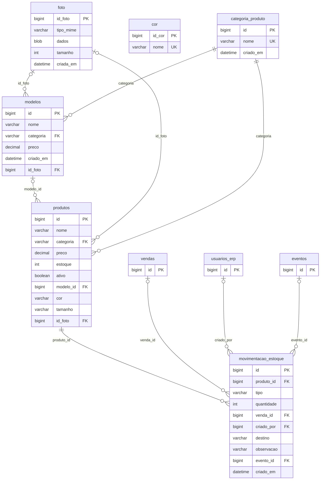

</details>

### 7.2 Vendas e pagamentos

<p align="center"></p>

<details>
<summary><b>MER conceitual (Chen) deste domínio, com todos os atributos</b></summary>
<br>
<p align="center"><a href="difeecult-readme-arquivos/mer/mer-vendas.png"></a></p>
<sub>Entidades em cinza pertencem a outros domínios e aparecem só para mostrar a ligação. <a href="difeecult-readme-arquivos/mer/mer-vendas.svg">Versão SVG</a>.</sub>
</details>


- **Venda com detalhe.** `vendas` é o cabeçalho (total, desconto, vendedor, evento, CPF na nota) e `venda_item` guarda cada produto com a quantidade e o preço do momento. Se o preço mudar depois, a venda antiga continua certa.
- **Brinde.** Um item do tipo BRINDE tem preço 0 e quantidade 1 (CHECK). A coluna `brinde_venda_id` com UNIQUE garante no máximo um brinde por venda.
- **Pagamento diversificado.** Uma venda de R$ 100 paga com R$ 40 no crédito, R$ 40 no Pix e R$ 20 em dinheiro gera três linhas em `caixa`, uma para cada forma. O fechamento do caixa bate por forma de pagamento.
- **Venda nunca é apagada.** Cancelar copia a venda para `vendas_canceladas` (UNIQUE em `venda_id`: só se cancela uma vez), devolve o estoque, estorna o caixa e guarda o motivo e quem cancelou.
- **Pagamento rastreável.** `pagamentos` tem chave de idempotência (UNIQUE) para não registrar a mesma cobrança duas vezes, e `pagamento_historico` guarda cada mudança de estado.
- **Cupons de influencer.** `descontos` guarda o código (UNIQUE), o desconto do cliente e a comissão do influencer sobre o que foi pago.

<details>
<summary><b>Diagrama Vendas e pagamentos com todas as colunas (Mermaid)</b></summary>

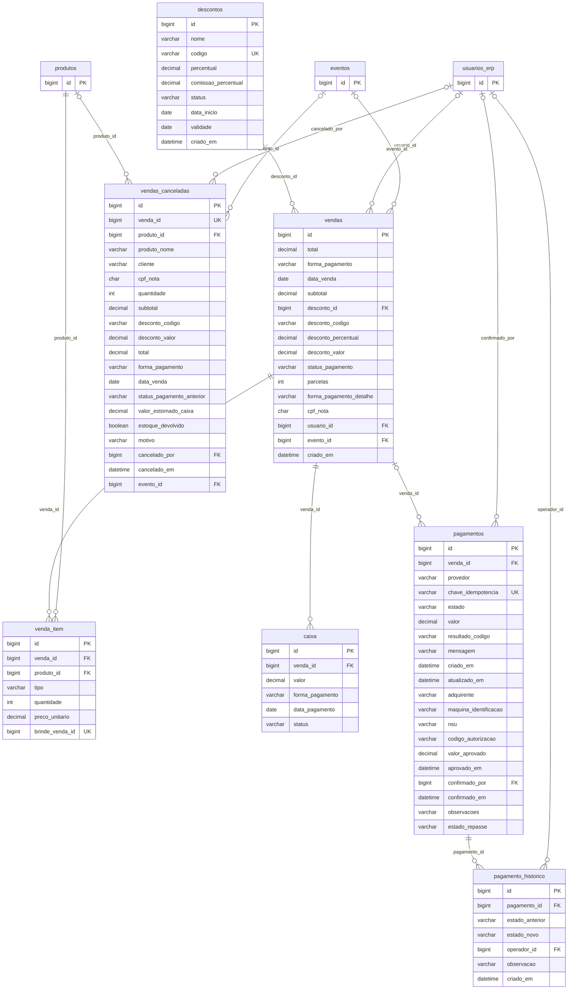

</details>

### 7.3 Eventos

<p align="center"></p>

<details>
<summary><b>MER conceitual (Chen) deste domínio, com todos os atributos</b></summary>
<br>
<p align="center"><a href="difeecult-readme-arquivos/mer/mer-eventos.png"></a></p>
<sub>Entidades em cinza pertencem a outros domínios e aparecem só para mostrar a ligação. <a href="difeecult-readme-arquivos/mer/mer-eventos.svg">Versão SVG</a>.</sub>
</details>


- **Cada evento com a sua conta.** `vendas`, `movimentacao_estoque` e `vendas_canceladas` têm `evento_id`. Assim o relatório mostra o que foi levado, o que vendeu e quanto entrou em cada evento.
- **Eventos que se repetem.** `eventos_anuais` guarda o mês e o dia; o sistema gera a edição de cada ano em `eventos`. O UNIQUE `(anual_id, ano_ocorrencia)` impede gerar o mesmo ano duas vezes.
- **Tipos editáveis.** `tipo_evento` tem chave interna fixa e nome exibido, os dois únicos, e a cor do calendário. Renomear não quebra os eventos, porque eles apontam para a chave.

<details>
<summary><b>Diagrama Eventos com todas as colunas (Mermaid)</b></summary>

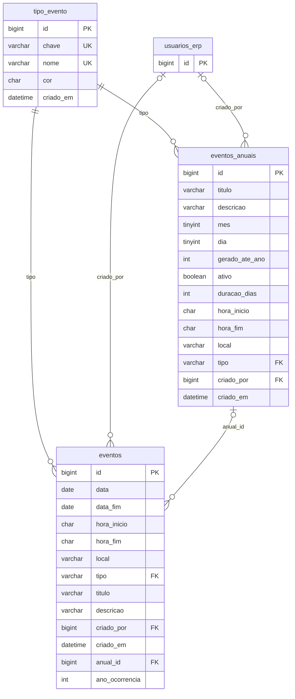

</details>

### 7.4 Preço & custo

<p align="center"></p>

<details>
<summary><b>MER conceitual (Chen) deste domínio, com todos os atributos</b></summary>
<br>
<p align="center"><a href="difeecult-readme-arquivos/mer/mer-preco.png"></a></p>
<sub>Entidades em cinza pertencem a outros domínios e aparecem só para mostrar a ligação. <a href="difeecult-readme-arquivos/mer/mer-preco.svg">Versão SVG</a>.</sub>
</details>


- **Relação 1:1 opcional.** Uma ficha pertence a um modelo **ou** a uma peça única. O CHECK `(modelo_id IS NULL) <> (produto_id IS NULL)` exige exatamente um dos dois, e os dois são UNIQUE: cada produto tem no máximo uma ficha.
- **Custo por etapa.** `ficha_custo_item` guarda tecido, corte, costura, estampa, etiqueta... O custo por peça é `quantidade × valor ÷ rendimento`: 1 kg de malha a R$ 62 que rende 3,5 camisetas custa R$ 17,71 por camiseta.
- **Preço pelo markup divisor.** Os percentuais (imposto, taxa, comissão, despesas, lucro) saem do preço de venda, então `preço = custo ÷ (1 − soma dos %)`. Percentual vazio na ficha usa o padrão da loja (`parametros`).

<details>
<summary><b>Diagrama Preço & custo com todas as colunas (Mermaid)</b></summary>

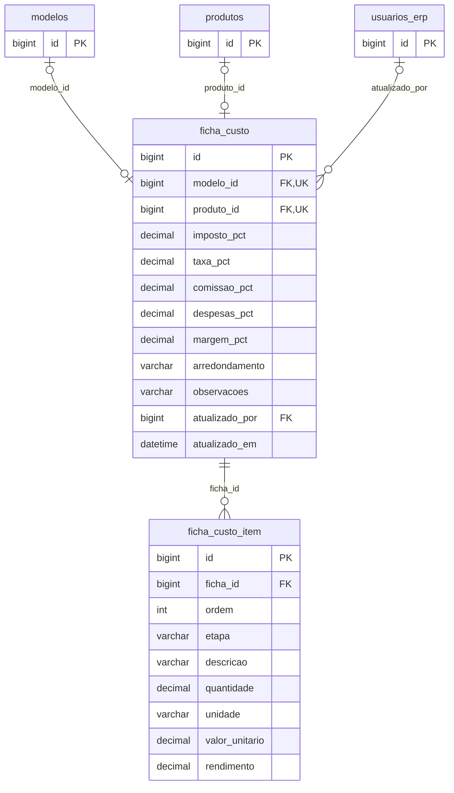

</details>

### 7.5 Fornecedores e financeiro

<p align="center"></p>

<details>
<summary><b>MER conceitual (Chen) deste domínio, com todos os atributos</b></summary>
<br>
<p align="center"><a href="difeecult-readme-arquivos/mer/mer-financeiro.png"></a></p>
<sub>Entidades em cinza pertencem a outros domínios e aparecem só para mostrar a ligação. <a href="difeecult-readme-arquivos/mer/mer-financeiro.svg">Versão SVG</a>.</sub>
</details>


- **Atributos multivalorados.** Um fornecedor tem vários telefones e e-mails: eles ficam em tabelas próprias com chave primária composta (1FN). Telefone e e-mail não se repetem entre fornecedores (UNIQUE).
- **Dívida fixa vira conta todo mês.** `contas_fixas` gera uma conta por competência. O UNIQUE `(conta_fixa_id, competencia)` impede gerar o mesmo mês duas vezes.
- **Dinheiro da empresa separado.** `contas` (a pagar), `contas_receber` e `caixa` mostram o resultado real da loja. Uma conta a receber pode nascer de uma venda (UNIQUE em `venda_id`).

<details>
<summary><b>Diagrama Fornecedores e financeiro com todas as colunas (Mermaid)</b></summary>

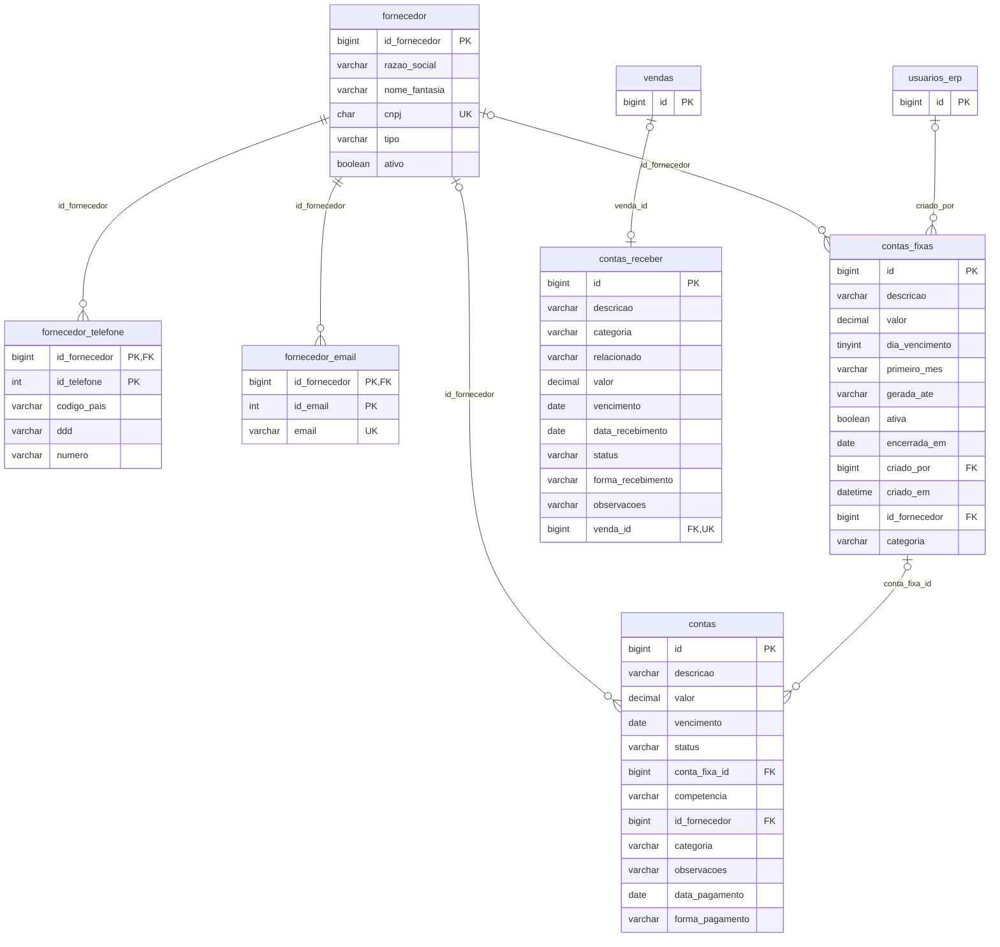

</details>

### 7.6 Pessoas e folha

<p align="center"></p>

<details>
<summary><b>MER conceitual (Chen) deste domínio, com todos os atributos</b></summary>
<br>
<p align="center"><a href="difeecult-readme-arquivos/mer/mer-pessoas.png"></a></p>
<sub>Entidades em cinza pertencem a outros domínios e aparecem só para mostrar a ligação. <a href="difeecult-readme-arquivos/mer/mer-pessoas.svg">Versão SVG</a>.</sub>
</details>


- **CLT ou PJ na mesma tabela.** `funcionario` tem `tipo_vinculo` e os campos de cada regime (PIS e CTPS para CLT; CNPJ e retenções para PJ). CPF e CNPJ são UNIQUE.
- **Holerite vira conta a pagar.** `holerite` guarda os lançamentos do mês e o cálculo (INSS, IRRF, FGTS, VT...). Ao gerar, cria a conta em `contas` (`holerite.conta_id`). O UNIQUE `(funcionario_id, competencia)` permite um holerite por mês.
- **Tabelas do ano.** `clt_tabela` guarda as faixas de INSS e IRRF por ano, e `empresa` (linha única, CHECK `id = 1`) os dados do cabeçalho dos documentos.

<details>
<summary><b>Diagrama Pessoas e folha com todas as colunas (Mermaid)</b></summary>

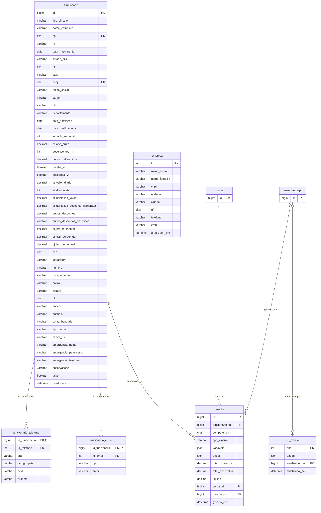

</details>

### 7.7 Acesso e sistema

<p align="center"></p>

<details>
<summary><b>MER conceitual (Chen) deste domínio, com todos os atributos</b></summary>
<br>
<p align="center"><a href="difeecult-readme-arquivos/mer/mer-acesso.png"></a></p>
<sub>Entidades em cinza pertencem a outros domínios e aparecem só para mostrar a ligação. <a href="difeecult-readme-arquivos/mer/mer-acesso.svg">Versão SVG</a>.</sub>
</details>


- **Permissão por tela.** `usuario_permissao` tem chave composta `(usuario_id, tela)` e diz se o usuário só vê ou também edita. Assim o vendedor usa o PDV sem ver custos e margens.
- **Auditoria.** `log_atividade` registra vendas, brindes, cancelamentos, cadastros e trocas de preço. O nome do usuário é copiado no momento da ação, para o histórico não mudar se a pessoa for renomeada.
- **Regras ajustáveis.** `parametros` é chave e valor: estoque negativo, dias de aviso, mínimo de peças para brinde, padrões de preço.

<details>
<summary><b>Diagrama Acesso e sistema com todas as colunas (Mermaid)</b></summary>

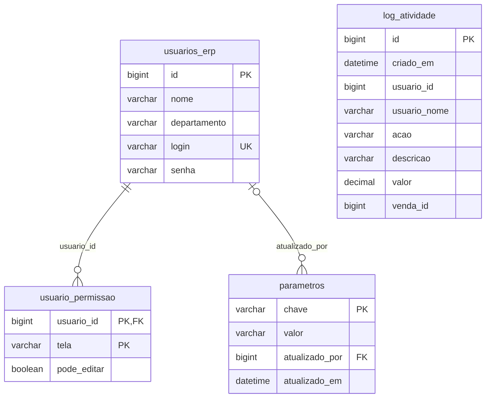

</details>


<p align="center"></p>

<a name="s8"></a>
<p align="center"></p>

| Recurso | Quantidade | Exemplos no DifeeCult |
|---|:-:|---|
| **Chave primária (PK)** | 34 | Toda tabela tem PK. Cinco são compostas: `usuario_permissao (usuario_id, tela)`, `funcionario_telefone`, `funcionario_email`, `fornecedor_telefone`, `fornecedor_email`. |
| **Chave estrangeira (FK)** | 46 | `venda_item.venda_id → vendas` (apagar a venda apaga os itens), `produtos.modelo_id → modelos` (bloqueia apagar modelo com variações), `vendas.evento_id → eventos` (apagar o evento deixa a venda sem evento). |
| **UNIQUE** | 24 | Login, cor, categoria, código do cupom, CPF/CNPJ, telefone e e-mail do fornecedor, variação `(modelo_id, cor, tamanho)`, holerite `(funcionario_id, competencia)`. |
| **CHECK** | 64 | Preço ≥ 0; CPF com 11 dígitos; brinde com preço 0 e quantidade 1; sinal da movimentação conforme o tipo; jornada de 1 a 44 h; cor do evento no formato `#rrggbb`; ficha de custo de um modelo **ou** de uma peça. |
| **Transação** | — | Venda + itens + baixa do estoque + caixa + log são gravados juntos: ou tudo, ou nada. |

**A PK identifica a linha; o UNIQUE garante que o conteúdo não se repete.** Por isso descrições (de conta, de custo, de evento) **não** são UNIQUE: repetir um texto explicativo não é erro. Só é UNIQUE o que identifica algo no mundo real.

<p align="center"></p>

<a name="s9"></a>
<p align="center"></p>

| Decisão | Por quê |
|---|---|
| Separar **modelo** de **variação** | O preço, a foto e a categoria são do modelo; o estoque é de cada cor e tamanho. Evita repetir dados e mantém o saldo exato. |
| **Preço copiado** em `venda_item` | O histórico de vendas não muda quando o preço do produto muda. |
| **Venda nunca é apagada** | Cancelar gera `vendas_canceladas`, devolve o estoque e estorna o caixa. Tudo fica rastreável. |
| **Uma linha no caixa por forma** | Permite o pagamento diversificado e o fechamento de caixa por forma de pagamento. |
| **`evento_id` em vendas e movimentações** | Cada evento fecha a própria conta: o que levou, o que vendeu, o que entrou. |
| **Telefones e e-mails em tabelas próprias** | Atributos multivalorados na 1ª forma normal, com PK composta e unicidade. |
| **Listas controladas** (cor, categoria, tipo de evento) | Evitam variações de escrita e permitem renomear em cascata. |
| **Livro de estoque** (`movimentacao_estoque`) | Todo saldo pode ser explicado linha a linha, com quem fez e onde. |
| **Ficha de custo 1:1 opcional** | Nem todo produto precisa de ficha; quem tem, tem no máximo uma. |
| **Nome do usuário copiado no log** | A auditoria mostra quem fez na época, mesmo que o usuário mude de nome. |
| **`parametros` em chave e valor** | Regras da loja mudam sem alterar a estrutura do banco. |
| **`empresa` com linha única** | CHECK `id = 1`: um só cabeçalho para holerites e recibos. |

<p align="center"></p>

<a name="s10"></a>
<p align="center"></p>

Todas as 34 tabelas e 328 colunas, geradas do `banco_mysql.sql`. Clique em uma tabela para abrir.

### Catálogo e estoque

<details>
<summary><b><code>categoria_produto</code></b> · 3 colunas · Lista controlada de categorias (Camiseta, Moletom, Boné...). Renomear atualiza os produtos em cascata.</summary>

| Coluna | Tipo | Nulo | Chave | Padrão | Descrição | Regras |
|---|---|:-:|:-:|---|---|---|
| `id` | bigint | não | PK | auto | Identificador do registro (chave primária, automático) |  |
| `nome` | varchar(40) | não | UQ |  | Nome da categoria (único) |  |
| `criado_em` | datetime | não |  | CURRENT_TIMESTAMP | Data e hora em que o registro foi criado |  |

</details>

<details>
<summary><b><code>cor</code></b> · 2 colunas · Lista controlada de cores. Evita "Preta" e "Preto" virarem duas cores.</summary>

| Coluna | Tipo | Nulo | Chave | Padrão | Descrição | Regras |
|---|---|:-:|:-:|---|---|---|
| `id_cor` | bigint | não | PK | auto | Identificador da cor (chave primária) |  |
| `nome` | varchar(30) | não | UQ |  | Nome da cor (único) | CHECK `CHAR_LENGTH(nome) BETWEEN 1 AND 30` |

</details>

<details>
<summary><b><code>foto</code></b> · 5 colunas · Fotos dos produtos guardadas no próprio banco (binário + tipo da imagem).</summary>

| Coluna | Tipo | Nulo | Chave | Padrão | Descrição | Regras |
|---|---|:-:|:-:|---|---|---|
| `id_foto` | bigint | não | PK | auto | Identificador da foto (chave primária) |  |
| `tipo_mime` | varchar(20) | não |  |  | image/jpeg, image/png ou image/webp | CHECK `tipo_mime IN ('image/jpeg', 'image/png', 'image/webp')` |
| `dados` | longblob | não |  |  | A imagem em binário |  |
| `tamanho` | int | não |  |  | Tamanho em bytes |  |
| `criada_em` | datetime | não |  | CURRENT_TIMESTAMP | Data e hora em que o registro foi criado |  |

</details>

<details>
<summary><b><code>modelos</code></b> · 6 colunas · O produto-pai: nome, categoria, preço e foto. Cada modelo gera variações de cor e tamanho em produtos.</summary>

| Coluna | Tipo | Nulo | Chave | Padrão | Descrição | Regras |
|---|---|:-:|:-:|---|---|---|
| `id` | bigint | não | PK | auto | Identificador do registro (chave primária, automático) |  |
| `nome` | varchar(120) | não |  |  | Nome do modelo (ex.: CAMISETA GTR R35 FNX) |  |
| `categoria` | varchar(40) | não | FK |  | Categoria (→ categoria_produto.nome) | → `categoria_produto.nome` (· ao alterar: cascata) |
| `preco` | decimal(12,2) | não |  |  | Preço de venda, vale para todas as variações | CHECK `preco >= 0` |
| `criado_em` | datetime | não |  | CURRENT_TIMESTAMP | Data e hora em que o registro foi criado |  |
| `id_foto` | bigint | sim | FK |  | Foto (→ foto) | → `foto.id_foto` (ao apagar: fica nulo) |

</details>

<details>
<summary><b><code>produtos</code></b> · 10 colunas · O que é vendido de fato: cada variação (modelo + cor + tamanho) com estoque próprio, ou uma peça única sem modelo.</summary>

| Coluna | Tipo | Nulo | Chave | Padrão | Descrição | Regras |
|---|---|:-:|:-:|---|---|---|
| `id` | bigint | não | PK | auto | Identificador do registro (chave primária, automático) |  |
| `nome` | varchar(120) | não |  |  | Nome exibido (modelo + cor + tamanho, ou o nome da peça única) |  |
| `categoria` | varchar(40) | não | FK |  | Categoria (→ categoria_produto.nome) | → `categoria_produto.nome` (· ao alterar: cascata) |
| `preco` | decimal(12,2) | não |  |  | Preço de venda | CHECK `preco >= 0` |
| `estoque` | int | não |  | 0 | Saldo atual em peças |  |
| `ativo` | tinyint(1) | não |  | 1 | Se está ativo (1) ou inativo (0) |  |
| `modelo_id` | bigint | sim | FK |  | Modelo de origem (→ modelos); vazio = peça única | UNIQUE (modelo_id, cor, tamanho)<br>→ `modelos.id` (ao apagar: bloqueia) |
| `cor` | varchar(30) | não |  | '' | Cor da variação | UNIQUE (modelo_id, cor, tamanho) |
| `tamanho` | varchar(30) | não |  | '' | Tamanho da variação (P, M, G...) | UNIQUE (modelo_id, cor, tamanho) |
| `id_foto` | bigint | sim | FK |  | Foto (→ foto) | → `foto.id_foto` (ao apagar: fica nulo) |

</details>

<details>
<summary><b><code>movimentacao_estoque</code></b> · 10 colunas · O livro do estoque: toda entrada, saída, venda, brinde, doação ou devolução, com quem fez e em qual evento.</summary>

| Coluna | Tipo | Nulo | Chave | Padrão | Descrição | Regras |
|---|---|:-:|:-:|---|---|---|
| `id` | bigint | não | PK | auto | Identificador do registro (chave primária, automático) |  |
| `produto_id` | bigint | não | FK |  | Produto (→ produtos) | → `produtos.id` (ao apagar: bloqueia) |
| `tipo` | varchar(10) | não |  |  | ENTRADA, SAIDA, VENDA, BRINDE, DOACAO ou DEVOLUCAO | CHECK `tipo IN ('ENTRADA', 'SAIDA', 'VENDA', 'BRINDE', 'DOACAO', 'DEVOLUCAO')`<br>CHECK `(tipo IN ('ENTRADA', 'DEVOLUCAO') AND quantidade > 0) OR (tipo IN ('SAIDA', 'VENDA', 'BRINDE', 'DOACAO') AND quantidade < 0)` |
| `quantidade` | int | não |  |  | Peças: positivo entra, negativo sai | CHECK `(tipo IN ('ENTRADA', 'DEVOLUCAO') AND quantidade > 0) OR (tipo IN ('SAIDA', 'VENDA', 'BRINDE', 'DOACAO') AND quantidade < 0)` |
| `venda_id` | bigint | sim | FK |  | Venda que gerou o movimento (→ vendas) | → `vendas.id` (ao apagar: fica nulo) |
| `criado_por` | bigint | sim | FK |  | Quem registrou (→ usuarios_erp) | → `usuarios_erp.id` (ao apagar: fica nulo) |
| `destino` | varchar(150) | não |  | '' | Para quem ou para onde foi a peça |  |
| `observacao` | varchar(300) | não |  | '' | Observação livre |  |
| `evento_id` | bigint | sim | FK |  | Evento ligado (→ eventos); vazio = loja | → `eventos.id` (ao apagar: fica nulo) |
| `criado_em` | datetime | não |  | CURRENT_TIMESTAMP | Data e hora em que o registro foi criado |  |

</details>

### Vendas e pagamentos

<details>
<summary><b><code>descontos</code></b> · 9 colunas · Cupons de influencer: código, desconto do cliente, comissão do influencer e período de validade.</summary>

| Coluna | Tipo | Nulo | Chave | Padrão | Descrição | Regras |
|---|---|:-:|:-:|---|---|---|
| `id` | bigint | não | PK | auto | Identificador do registro (chave primária, automático) |  |
| `nome` | varchar(80) | não |  |  | Nome do influencer ou da campanha |  |
| `codigo` | varchar(40) | não | UQ |  | Código do cupom (único) |  |
| `percentual` | decimal(5,2) | não |  |  | Desconto dado ao cliente (%) | CHECK `percentual > 0 AND percentual <= 100` |
| `comissao_percentual` | decimal(5,2) | não |  | 0 | Comissão do influencer sobre o valor pago (%) | CHECK `comissao_percentual >= 0 AND comissao_percentual <= 100` |
| `status` | varchar(10) | não |  | 'Ativo' | Ativo ou Inativo | CHECK `status IN ('Ativo', 'Inativo')` |
| `data_inicio` | date | sim |  |  | Início da validade |  |
| `validade` | date | sim |  |  | Fim da validade |  |
| `criado_em` | datetime | não |  | CURRENT_TIMESTAMP | Data e hora em que o registro foi criado |  |

</details>

<details>
<summary><b><code>vendas</code></b> · 16 colunas · Cabeçalho da venda: total, desconto, forma de pagamento, CPF na nota, vendedor e evento.</summary>

| Coluna | Tipo | Nulo | Chave | Padrão | Descrição | Regras |
|---|---|:-:|:-:|---|---|---|
| `id` | bigint | não | PK | auto | Identificador do registro (chave primária, automático) |  |
| `total` | decimal(12,2) | não |  |  | Valor final cobrado, já com desconto | CHECK `total >= 0` |
| `forma_pagamento` | varchar(30) | não |  | 'Dinheiro' | Forma de pagamento |  |
| `data_venda` | date | não |  |  | Dia da venda |  |
| `subtotal` | decimal(12,2) | não |  | 0 | Valor antes do desconto |  |
| `desconto_id` | bigint | sim | FK |  | Cupom usado (→ descontos) | → `descontos.id` (ao apagar: fica nulo) |
| `desconto_codigo` | varchar(40) | não |  | '' | Código do cupom no momento da venda |  |
| `desconto_percentual` | decimal(5,2) | não |  | 0 | Percentual de desconto aplicado |  |
| `desconto_valor` | decimal(12,2) | não |  | 0 | Desconto em reais |  |
| `status_pagamento` | varchar(30) | não |  | 'confirmado' | Situação do pagamento (confirmado, aguardando, cancelado...) |  |
| `parcelas` | int | não |  | 1 | Parcelas no crédito |  |
| `forma_pagamento_detalhe` | varchar(40) | não |  | '' | Detalhe do pagamento (ex.: as partes do pagamento diversificado) |  |
| `cpf_nota` | char(11) | sim |  |  | CPF na nota (11 dígitos); vazio = cliente não quis | CHECK `cpf_nota IS NULL OR cpf_nota REGEXP '^[0-9]{11}$'` |
| `usuario_id` | bigint | sim | FK |  | Vendedor (→ usuarios_erp) | → `usuarios_erp.id` (ao apagar: fica nulo) |
| `evento_id` | bigint | sim | FK |  | Evento ligado (→ eventos); vazio = loja | → `eventos.id` (ao apagar: fica nulo) |
| `criado_em` | datetime(3) | sim |  |  | Data e hora exatas da venda |  |

</details>

<details>
<summary><b><code>venda_item</code></b> · 7 colunas · Os itens de cada venda (VENDA ou BRINDE), com quantidade e o preço do momento.</summary>

| Coluna | Tipo | Nulo | Chave | Padrão | Descrição | Regras |
|---|---|:-:|:-:|---|---|---|
| `id` | bigint | não | PK | auto | Identificador do registro (chave primária, automático) |  |
| `venda_id` | bigint | não | FK |  | Venda ligada (→ vendas) | UNIQUE (venda_id, produto_id, tipo)<br>→ `vendas.id` (ao apagar: cascata) |
| `produto_id` | bigint | não | FK |  | Produto (→ produtos) | UNIQUE (venda_id, produto_id, tipo)<br>→ `produtos.id` (ao apagar: bloqueia) |
| `tipo` | varchar(10) | não |  | 'VENDA' | VENDA ou BRINDE | CHECK `tipo IN ('VENDA', 'BRINDE')`<br>CHECK `tipo <> 'BRINDE' OR (preco_unitario = 0 AND quantidade = 1)`<br>UNIQUE (venda_id, produto_id, tipo) |
| `quantidade` | int | não |  |  | Quantidade de peças | CHECK `quantidade > 0`<br>CHECK `tipo <> 'BRINDE' OR (preco_unitario = 0 AND quantidade = 1)` |
| `preco_unitario` | decimal(12,2) | não |  |  | Preço no momento da venda (0 no brinde) | CHECK `preco_unitario >= 0`<br>CHECK `tipo <> 'BRINDE' OR (preco_unitario = 0 AND quantidade = 1)` |
| `brinde_venda_id` | bigint | sim | UQ |  | Preenchido só no brinde; garante no máximo 1 brinde por venda |  |

</details>

<details>
<summary><b><code>caixa</code></b> · 6 colunas · Entradas de dinheiro por forma de pagamento. No pagamento diversificado, uma linha para cada forma.</summary>

| Coluna | Tipo | Nulo | Chave | Padrão | Descrição | Regras |
|---|---|:-:|:-:|---|---|---|
| `id` | bigint | não | PK | auto | Identificador do registro (chave primária, automático) |  |
| `venda_id` | bigint | não | FK |  | Venda ligada (→ vendas) | → `vendas.id` (ao apagar: cascata) |
| `valor` | decimal(12,2) | não |  |  | Valor que entrou | CHECK `valor >= 0` |
| `forma_pagamento` | varchar(30) | não |  |  | Forma de pagamento |  |
| `data_pagamento` | date | não |  |  | Dia do pagamento |  |
| `status` | varchar(20) | não |  | 'Pago' | Situação (pago, estornado...) |  |

</details>

<details>
<summary><b><code>pagamentos</code></b> · 20 colunas · O pagamento de cada venda: estado (aguardando, aprovado, recusado...), maquininha, NSU e chave de idempotência.</summary>

| Coluna | Tipo | Nulo | Chave | Padrão | Descrição | Regras |
|---|---|:-:|:-:|---|---|---|
| `id` | bigint | não | PK | auto | Identificador do registro (chave primária, automático) |  |
| `venda_id` | bigint | sim | FK |  | Venda ligada (→ vendas) | → `vendas.id` (ao apagar: cascata) |
| `provedor` | varchar(40) | não |  |  | Quem processou (manual, Getnet, InfinitePay) |  |
| `chave_idempotencia` | varchar(120) | não | UQ |  | Evita registrar o mesmo pagamento duas vezes (única) |  |
| `estado` | varchar(30) | não |  |  | aguardando, aprovado, recusado, cancelado... |  |
| `valor` | decimal(12,2) | não |  |  | Valor em reais | CHECK `valor >= 0` |
| `resultado_codigo` | varchar(60) | sim |  |  | Código de retorno da operadora |  |
| `mensagem` | varchar(500) | não |  | '' | Mensagem da operadora |  |
| `criado_em` | datetime | não |  | CURRENT_TIMESTAMP | Data e hora em que o registro foi criado |  |
| `atualizado_em` | datetime | não |  | CURRENT_TIMESTAMP | Data e hora da última alteração |  |
| `adquirente` | varchar(80) | não |  | '' | Adquirente do cartão |  |
| `maquina_identificacao` | varchar(80) | não |  | '' | Maquininha usada |  |
| `nsu` | varchar(60) | não |  | '' | NSU da transação |  |
| `codigo_autorizacao` | varchar(60) | não |  | '' | Código de autorização |  |
| `valor_aprovado` | decimal(12,2) | sim |  |  | Valor aprovado pela operadora |  |
| `aprovado_em` | datetime | sim |  |  | Quando foi aprovado |  |
| `confirmado_por` | bigint | sim | FK |  | Quem confirmou no caixa (→ usuarios_erp) | → `usuarios_erp.id` (ao apagar: fica nulo) |
| `confirmado_em` | datetime | sim |  |  | Quando foi confirmado |  |
| `observacoes` | varchar(1000) | não |  | '' | Observações livres |  |
| `estado_repasse` | varchar(30) | não |  | 'nao_aplicavel' | Repasse da operadora: não aplicável, aguardando, repassado ou divergência | CHECK `estado_repasse IN ('nao_aplicavel', 'aguardando_repasse', 'repassado', 'divergencia')` |

</details>

<details>
<summary><b><code>pagamento_historico</code></b> · 7 colunas · Cada mudança de estado de um pagamento, com quem mudou e quando.</summary>

| Coluna | Tipo | Nulo | Chave | Padrão | Descrição | Regras |
|---|---|:-:|:-:|---|---|---|
| `id` | bigint | não | PK | auto | Identificador do registro (chave primária, automático) |  |
| `pagamento_id` | bigint | não | FK |  | Pagamento (→ pagamentos) | → `pagamentos.id` (ao apagar: cascata) |
| `estado_anterior` | varchar(30) | sim |  |  | Estado antes da mudança |  |
| `estado_novo` | varchar(30) | não |  |  | Estado depois da mudança |  |
| `operador_id` | bigint | sim | FK |  | Quem mudou (→ usuarios_erp) | → `usuarios_erp.id` (ao apagar: fica nulo) |
| `observacao` | varchar(500) | não |  | '' | Observação livre |  |
| `criado_em` | datetime | não |  | CURRENT_TIMESTAMP | Data e hora em que o registro foi criado |  |

</details>

<details>
<summary><b><code>vendas_canceladas</code></b> · 20 colunas · Cópia da venda cancelada com motivo, quem cancelou e o que voltou ao estoque e ao caixa. Venda nunca é apagada.</summary>

| Coluna | Tipo | Nulo | Chave | Padrão | Descrição | Regras |
|---|---|:-:|:-:|---|---|---|
| `id` | bigint | não | PK | auto | Identificador do registro (chave primária, automático) |  |
| `venda_id` | bigint | não | UQ |  | Venda cancelada (→ vendas, única) |  |
| `produto_id` | bigint | sim | FK |  | Produto (→ produtos) | → `produtos.id` (ao apagar: fica nulo) |
| `produto_nome` | varchar(500) | não |  |  | Resumo dos itens e do brinde |  |
| `cliente` | varchar(120) | não |  | '' | Cliente, se informado |  |
| `cpf_nota` | char(11) | sim |  |  | CPF na nota da venda | CHECK `cpf_nota IS NULL OR cpf_nota REGEXP '^[0-9]{11}$'` |
| `quantidade` | int | não |  |  | Peças da venda | CHECK `quantidade > 0` |
| `subtotal` | decimal(12,2) | não |  | 0 | Subtotal da venda |  |
| `desconto_codigo` | varchar(40) | não |  | '' | Cupom usado |  |
| `desconto_valor` | decimal(12,2) | não |  | 0 | Desconto em reais |  |
| `total` | decimal(12,2) | não |  |  | Total da venda | CHECK `total >= 0` |
| `forma_pagamento` | varchar(30) | não |  |  | Forma de pagamento |  |
| `data_venda` | date | não |  |  | Dia da venda |  |
| `status_pagamento_anterior` | varchar(30) | não |  |  | Situação do pagamento antes de cancelar |  |
| `valor_estornado_caixa` | decimal(12,2) | não |  | 0 | Quanto saiu do caixa no estorno | CHECK `valor_estornado_caixa >= 0` |
| `estoque_devolvido` | tinyint(1) | não |  | 1 | Se as peças voltaram ao estoque |  |
| `motivo` | varchar(300) | não |  |  | Motivo do cancelamento (3 a 300 caracteres) | CHECK `CHAR_LENGTH(motivo) BETWEEN 3 AND 300` |
| `cancelado_por` | bigint | sim | FK |  | Quem cancelou (→ usuarios_erp) | → `usuarios_erp.id` (ao apagar: fica nulo) |
| `cancelado_em` | datetime | não |  | CURRENT_TIMESTAMP | Quando cancelou |  |
| `evento_id` | bigint | sim | FK |  | Evento ligado (→ eventos); vazio = loja | → `eventos.id` (ao apagar: fica nulo) |

</details>

### Eventos

<details>
<summary><b><code>tipo_evento</code></b> · 5 colunas · Tipos de evento editáveis (encontro, corrida, feira...), cada um com sua cor no calendário.</summary>

| Coluna | Tipo | Nulo | Chave | Padrão | Descrição | Regras |
|---|---|:-:|:-:|---|---|---|
| `id` | bigint | não | PK | auto | Identificador do registro (chave primária, automático) |  |
| `chave` | varchar(40) | não | UQ |  | Código interno do tipo (único, não muda ao renomear) |  |
| `nome` | varchar(40) | não | UQ |  | Nome exibido (único) |  |
| `cor` | char(7) | não |  | '#94a3b8' | Cor no calendário (#rrggbb) | CHECK `cor REGEXP '^#[0-9a-f]{6}$'` |
| `criado_em` | datetime | não |  | CURRENT_TIMESTAMP | Data e hora em que o registro foi criado |  |

</details>

<details>
<summary><b><code>eventos</code></b> · 13 colunas · Agenda de eventos: data, horário, local, tipo. Vendas e saídas de estoque apontam para o evento.</summary>

| Coluna | Tipo | Nulo | Chave | Padrão | Descrição | Regras |
|---|---|:-:|:-:|---|---|---|
| `id` | bigint | não | PK | auto | Identificador do registro (chave primária, automático) |  |
| `data` | date | não |  |  | Primeiro dia | CHECK `data_fim IS NULL OR data_fim >= data` |
| `data_fim` | date | sim |  |  | Último dia (eventos de vários dias) | CHECK `data_fim IS NULL OR data_fim >= data` |
| `hora_inicio` | char(5) | sim |  |  | Hora de início |  |
| `hora_fim` | char(5) | sim |  |  | Hora de término |  |
| `local` | varchar(120) | não |  | '' | Local |  |
| `tipo` | varchar(40) | não | FK | 'outro' | Tipo (→ tipo_evento.chave) | → `tipo_evento.chave` (· ao alterar: cascata) |
| `titulo` | varchar(160) | não |  |  | Título |  |
| `descricao` | varchar(500) | não |  | '' | Detalhes do evento |  |
| `criado_por` | bigint | sim | FK |  | Usuário que criou o registro | → `usuarios_erp.id` (ao apagar: fica nulo) |
| `criado_em` | datetime | não |  | CURRENT_TIMESTAMP | Data e hora em que o registro foi criado |  |
| `anual_id` | bigint | sim | FK |  | Evento anual de origem (→ eventos_anuais) | UNIQUE (anual_id, ano_ocorrencia)<br>→ `eventos_anuais.id` (ao apagar: fica nulo) |
| `ano_ocorrencia` | int | sim |  |  | Ano desta edição | UNIQUE (anual_id, ano_ocorrencia) |

</details>

<details>
<summary><b><code>eventos_anuais</code></b> · 14 colunas · Eventos que se repetem todo ano; o sistema gera a edição de cada ano em eventos.</summary>

| Coluna | Tipo | Nulo | Chave | Padrão | Descrição | Regras |
|---|---|:-:|:-:|---|---|---|
| `id` | bigint | não | PK | auto | Identificador do registro (chave primária, automático) |  |
| `titulo` | varchar(160) | não |  |  | Título |  |
| `descricao` | varchar(500) | não |  | '' | Detalhes do evento |  |
| `mes` | tinyint | não |  |  | Mês do evento (1 a 12) | CHECK `mes BETWEEN 1 AND 12` |
| `dia` | tinyint | não |  |  | Dia do evento (1 a 31) | CHECK `dia BETWEEN 1 AND 31` |
| `gerado_ate_ano` | int | não |  |  | Último ano já gerado em eventos |  |
| `ativo` | tinyint(1) | não |  | 1 | Se está ativo (1) ou inativo (0) |  |
| `duracao_dias` | int | não |  | 0 | Dias além do primeiro (0 = um dia só) |  |
| `hora_inicio` | char(5) | sim |  |  | Hora de início |  |
| `hora_fim` | char(5) | sim |  |  | Hora de término |  |
| `local` | varchar(120) | não |  | '' | Local |  |
| `tipo` | varchar(40) | não | FK | 'outro' | Tipo (→ tipo_evento.chave) | → `tipo_evento.chave` (· ao alterar: cascata) |
| `criado_por` | bigint | sim | FK |  | Usuário que criou o registro | → `usuarios_erp.id` (ao apagar: fica nulo) |
| `criado_em` | datetime | não |  | CURRENT_TIMESTAMP | Data e hora em que o registro foi criado |  |

</details>

### Preço & custo

<details>
<summary><b><code>ficha_custo</code></b> · 12 colunas · Ficha de custo de um modelo OU de uma peça única, com os percentuais da venda (imposto, taxa, comissão, despesas, lucro).</summary>

| Coluna | Tipo | Nulo | Chave | Padrão | Descrição | Regras |
|---|---|:-:|:-:|---|---|---|
| `id` | bigint | não | PK | auto | Identificador do registro (chave primária, automático) |  |
| `modelo_id` | bigint | sim | FK UQ |  | Modelo (→ modelos); preenchido OU produto_id | CHECK `(modelo_id IS NULL) <> (produto_id IS NULL)`<br>→ `modelos.id` (ao apagar: cascata) |
| `produto_id` | bigint | sim | FK UQ |  | Peça única (→ produtos); preenchido OU modelo_id | CHECK `(modelo_id IS NULL) <> (produto_id IS NULL)`<br>→ `produtos.id` (ao apagar: cascata) |
| `imposto_pct` | decimal(5,2) | sim |  |  | Impostos sobre a venda (%); vazio = padrão da loja | CHECK `(imposto_pct IS NULL OR imposto_pct BETWEEN 0 AND 99.99) AND (taxa_pct IS NULL OR taxa_pct BETWEEN 0 AND 99.99` |
| `taxa_pct` | decimal(5,2) | sim |  |  | Taxa do cartão/marketplace (%) | CHECK `(imposto_pct IS NULL OR imposto_pct BETWEEN 0 AND 99.99) AND (taxa_pct IS NULL OR taxa_pct BETWEEN 0 AND 99.99` |
| `comissao_pct` | decimal(5,2) | sim |  |  | Comissão (%) |  |
| `despesas_pct` | decimal(5,2) | sim |  |  | Despesas fixas da loja (% do faturamento) |  |
| `margem_pct` | decimal(5,2) | sim |  |  | Lucro desejado (%) |  |
| `arredondamento` | varchar(10) | sim |  |  | 90 (termina em ,90), inteiro ou centavo | CHECK `arredondamento IS NULL OR arredondamento IN ('90', 'inteiro', 'centavo')` |
| `observacoes` | varchar(500) | não |  | '' | Observações livres |  |
| `atualizado_por` | bigint | sim | FK |  | Usuário que alterou por último | → `usuarios_erp.id` (ao apagar: fica nulo) |
| `atualizado_em` | datetime | não |  | CURRENT_TIMESTAMP ON UPDATE CURRENT_TIMESTAMP | Data e hora da última alteração |  |

</details>

<details>
<summary><b><code>ficha_custo_item</code></b> · 9 colunas · Cada custo da peça: etapa, quantidade, unidade, valor e rendimento (quantas peças saem).</summary>

| Coluna | Tipo | Nulo | Chave | Padrão | Descrição | Regras |
|---|---|:-:|:-:|---|---|---|
| `id` | bigint | não | PK | auto | Identificador do registro (chave primária, automático) |  |
| `ficha_id` | bigint | não | FK |  | Ficha (→ ficha_custo) | → `ficha_custo.id` (ao apagar: cascata) |
| `ordem` | int | não |  | 0 | Posição na lista |  |
| `etapa` | varchar(30) | não |  |  | Tecido, corte, costura, estampa, etiqueta e embalagem... |  |
| `descricao` | varchar(80) | não |  | '' | Detalhe (ex.: malha 30.1 penteada) |  |
| `quantidade` | decimal(14,4) | não |  |  | Quantidade usada | CHECK `quantidade > 0 AND valor_unitario >= 0 AND rendimento > 0` |
| `unidade` | varchar(5) | não |  |  | m, kg, un, peça ou hora | CHECK `unidade IN ('m', 'kg', 'un', 'peça', 'hora')` |
| `valor_unitario` | decimal(14,4) | não |  |  | Valor por unidade | CHECK `quantidade > 0 AND valor_unitario >= 0 AND rendimento > 0` |
| `rendimento` | decimal(12,4) | não |  | 1 | Quantas peças saem dessa quantidade | CHECK `quantidade > 0 AND valor_unitario >= 0 AND rendimento > 0` |

</details>

### Fornecedores e financeiro

<details>
<summary><b><code>fornecedor</code></b> · 6 colunas · Fornecedores e prestadores PJ: razão social, nome fantasia, CNPJ e tipo.</summary>

| Coluna | Tipo | Nulo | Chave | Padrão | Descrição | Regras |
|---|---|:-:|:-:|---|---|---|
| `id_fornecedor` | bigint | não | PK | auto | Identificador do fornecedor (chave primária) |  |
| `razao_social` | varchar(200) | não |  |  | Razão social |  |
| `nome_fantasia` | varchar(200) | não |  | '' | Nome fantasia |  |
| `cnpj` | char(14) | não | UQ |  | CNPJ, só os 14 dígitos | CHECK `cnpj REGEXP '^[0-9]{14}$'` |
| `tipo` | varchar(20) | não |  | 'FORNECEDOR' | FORNECEDOR ou PRESTADOR_PJ | CHECK `tipo IN ('FORNECEDOR', 'PRESTADOR_PJ')` |
| `ativo` | tinyint(1) | não |  | 1 | Se está ativo (1) ou inativo (0) |  |

</details>

<details>
<summary><b><code>fornecedor_telefone</code></b> · 5 colunas · Telefones do fornecedor (atributo multivalorado). PK composta; o mesmo número não se repete entre fornecedores.</summary>

| Coluna | Tipo | Nulo | Chave | Padrão | Descrição | Regras |
|---|---|:-:|:-:|---|---|---|
| `id_fornecedor` | bigint | não | PK FK |  | Fornecedor (→ fornecedor) | → `fornecedor.id_fornecedor` (ao apagar: cascata) |
| `id_telefone` | int | não | PK |  | Número do telefone dentro do fornecedor |  |
| `codigo_pais` | varchar(4) | não |  |  | Código do país (55 = Brasil) | CHECK `codigo_pais REGEXP '^[0-9]{1,4}$'`<br>UNIQUE (codigo_pais, ddd, numero) |
| `ddd` | varchar(3) | não |  | '' | DDD | CHECK `ddd REGEXP '^[0-9]{0,3}$'`<br>UNIQUE (codigo_pais, ddd, numero) |
| `numero` | varchar(20) | não |  |  | Número | CHECK `numero REGEXP '^[0-9]+$'`<br>UNIQUE (codigo_pais, ddd, numero) |

</details>

<details>
<summary><b><code>fornecedor_email</code></b> · 3 colunas · E-mails do fornecedor (atributo multivalorado). PK composta; o mesmo e-mail não se repete.</summary>

| Coluna | Tipo | Nulo | Chave | Padrão | Descrição | Regras |
|---|---|:-:|:-:|---|---|---|
| `id_fornecedor` | bigint | não | PK FK |  | Fornecedor (→ fornecedor) | → `fornecedor.id_fornecedor` (ao apagar: cascata) |
| `id_email` | int | não | PK |  | Número do e-mail dentro do fornecedor |  |
| `email` | varchar(254) | não | UQ |  | Endereço de e-mail |  |

</details>

<details>
<summary><b><code>contas</code></b> · 12 colunas · Contas a pagar: descrição, valor, vencimento, situação, categoria e, se for o caso, o fornecedor e a conta fixa de origem.</summary>

| Coluna | Tipo | Nulo | Chave | Padrão | Descrição | Regras |
|---|---|:-:|:-:|---|---|---|
| `id` | bigint | não | PK | auto | Identificador do registro (chave primária, automático) |  |
| `descricao` | varchar(200) | não |  |  | Descrição |  |
| `valor` | decimal(12,2) | não |  |  | Valor em reais | CHECK `valor >= 0` |
| `vencimento` | date | não |  |  | Data de vencimento |  |
| `status` | varchar(20) | não |  | 'Pendente' | Pendente, Pago, Vencido... |  |
| `conta_fixa_id` | bigint | sim | FK |  | Conta fixa que gerou esta conta (→ contas_fixas) | UNIQUE (conta_fixa_id, competencia)<br>→ `contas_fixas.id` (ao apagar: fica nulo) |
| `competencia` | varchar(10) | sim |  |  | Mês de referência (AAAA-MM) | UNIQUE (conta_fixa_id, competencia) |
| `id_fornecedor` | bigint | sim | FK |  | Fornecedor (→ fornecedor) | → `fornecedor.id_fornecedor` (ao apagar: bloqueia) |
| `categoria` | varchar(60) | não |  | '' | Categoria |  |
| `observacoes` | varchar(500) | não |  | '' | Observações livres |  |
| `data_pagamento` | date | sim |  |  | Dia em que foi paga |  |
| `forma_pagamento` | varchar(30) | não |  | '' | Como foi paga |  |

</details>

<details>
<summary><b><code>contas_fixas</code></b> · 12 colunas · Dívidas que se repetem todo mês (aluguel, internet, contador); geram uma conta por competência.</summary>

| Coluna | Tipo | Nulo | Chave | Padrão | Descrição | Regras |
|---|---|:-:|:-:|---|---|---|
| `id` | bigint | não | PK | auto | Identificador do registro (chave primária, automático) |  |
| `descricao` | varchar(200) | não |  |  | Descrição |  |
| `valor` | decimal(12,2) | não |  |  | Valor em reais | CHECK `valor >= 0` |
| `dia_vencimento` | tinyint | não |  |  | Dia do mês em que vence (1 a 31) | CHECK `dia_vencimento BETWEEN 1 AND 31` |
| `primeiro_mes` | varchar(10) | não |  |  | Primeira competência gerada |  |
| `gerada_ate` | varchar(10) | sim |  |  | Última competência já gerada |  |
| `ativa` | tinyint(1) | não |  | 1 | Se está ativa (1) ou encerrada (0) |  |
| `encerrada_em` | date | sim |  |  | Quando deixou de ser gerada |  |
| `criado_por` | bigint | sim | FK |  | Usuário que criou o registro | → `usuarios_erp.id` (ao apagar: fica nulo) |
| `criado_em` | datetime | não |  | CURRENT_TIMESTAMP | Data e hora em que o registro foi criado |  |
| `id_fornecedor` | bigint | sim | FK |  | Fornecedor (→ fornecedor) | → `fornecedor.id_fornecedor` (ao apagar: bloqueia) |
| `categoria` | varchar(60) | não |  | '' | Categoria |  |

</details>

<details>
<summary><b><code>contas_receber</code></b> · 11 colunas · Contas a receber: valor, vencimento, situação e a venda de origem, quando houver.</summary>

| Coluna | Tipo | Nulo | Chave | Padrão | Descrição | Regras |
|---|---|:-:|:-:|---|---|---|
| `id` | bigint | não | PK | auto | Identificador do registro (chave primária, automático) |  |
| `descricao` | varchar(200) | não |  |  | Descrição |  |
| `categoria` | varchar(80) | não |  | '' | Categoria |  |
| `relacionado` | varchar(120) | não |  | '' | De quem vamos receber |  |
| `valor` | decimal(12,2) | não |  |  | Valor em reais | CHECK `valor >= 0` |
| `vencimento` | date | não |  |  | Data de vencimento |  |
| `data_recebimento` | date | sim |  |  | Dia em que foi recebida |  |
| `status` | varchar(20) | não |  | 'Pendente' | Pendente, Recebido, Vencido ou Cancelado | CHECK `status IN ('Pendente', 'Recebido', 'Vencido', 'Cancelado')` |
| `forma_recebimento` | varchar(30) | não |  | '' | Como foi recebida |  |
| `observacoes` | varchar(1000) | não |  | '' | Observações livres |  |
| `venda_id` | bigint | sim | FK UQ |  | Venda de origem (→ vendas, única) | → `vendas.id` (ao apagar: cascata) |

</details>

### Pessoas e folha

<details>
<summary><b><code>funcionario</code></b> · 49 colunas · Cadastro completo de funcionários CLT e prestadores PJ: documentos, cargo, salário, benefícios, endereço, banco e contato de emergência.</summary>

| Coluna | Tipo | Nulo | Chave | Padrão | Descrição | Regras |
|---|---|:-:|:-:|---|---|---|
| `id` | bigint | não | PK | auto | Identificador do registro (chave primária, automático) |  |
| `tipo_vinculo` | varchar(3) | não |  | 'CLT' | CLT ou PJ | CHECK `tipo_vinculo IN ('CLT', 'PJ')` |
| `nome_completo` | varchar(150) | não |  |  | Nome completo (5 a 150 caracteres) | CHECK `CHAR_LENGTH(nome_completo) BETWEEN 5 AND 150` |
| `cpf` | char(11) | não | UQ |  | CPF, só os 11 dígitos | CHECK `cpf REGEXP '^[0-9]{11}$'` |
| `rg` | varchar(20) | não |  | '' | RG |  |
| `data_nascimento` | date | sim |  |  | Data de nascimento |  |
| `estado_civil` | varchar(20) | não |  | '' | Estado civil |  |
| `pis` | char(11) | não |  | '' | PIS/NIS (CLT) |  |
| `ctps` | varchar(30) | não |  | '' | Carteira de trabalho (CLT) |  |
| `cnpj` | char(14) | sim | UQ |  | CNPJ do prestador (PJ) | CHECK `cnpj IS NULL OR cnpj REGEXP '^[0-9]{14}$'` |
| `razao_social` | varchar(150) | não |  | '' | Empresa do prestador (PJ) |  |
| `cargo` | varchar(80) | não |  | '' | Cargo |  |
| `cbo` | varchar(10) | não |  | '' | Código CBO da ocupação |  |
| `departamento` | varchar(60) | não |  | '' | Departamento |  |
| `data_admissao` | date | sim |  |  | Data de admissão | CHECK `data_desligamento IS NULL OR data_admissao IS NULL OR data_desligamento >= data_admissao` |
| `data_desligamento` | date | sim |  |  | Data de desligamento | CHECK `data_desligamento IS NULL OR data_admissao IS NULL OR data_desligamento >= data_admissao` |
| `jornada_semanal` | int | não |  | 44 | Horas por semana (1 a 44) | CHECK `jornada_semanal BETWEEN 1 AND 44` |
| `salario_bruto` | decimal(12,2) | não |  |  | Salário (CLT) ou valor do contrato (PJ) | CHECK `salario_bruto > 0` |
| `dependentes_irrf` | int | não |  | 0 | Dependentes para o IRRF | CHECK `dependentes_irrf BETWEEN 0 AND 20` |
| `pensao_alimenticia` | decimal(12,2) | não |  | 0 | Pensão descontada por mês | CHECK `pensao_alimenticia >= 0 AND vt_valor_diario >= 0 AND alimentacao_valor >= 0 AND outros_descontos >= 0` |
| `recebe_vt` | tinyint(1) | não |  | 0 | Recebe vale-transporte |  |
| `descontar_vt` | tinyint(1) | não |  | 1 | Desconta os 6% do VT |  |
| `vt_valor_diario` | decimal(12,2) | não |  | 0 | Valor diário do VT | CHECK `pensao_alimenticia >= 0 AND vt_valor_diario >= 0 AND alimentacao_valor >= 0 AND outros_descontos >= 0` |
| `vt_dias_uteis` | int | não |  | 22 | Dias úteis de VT no mês | CHECK `vt_dias_uteis BETWEEN 0 AND 31` |
| `alimentacao_valor` | decimal(12,2) | não |  | 0 | Vale-alimentação/refeição | CHECK `pensao_alimenticia >= 0 AND vt_valor_diario >= 0 AND alimentacao_valor >= 0 AND outros_descontos >= 0` |
| `alimentacao_desconto_percentual` | decimal(5,2) | não |  | 0 | Desconto do benefício (até 20%, PAT) | CHECK `alimentacao_desconto_percentual BETWEEN 0 AND 20` |
| `outros_descontos` | decimal(12,2) | não |  | 0 | Outros descontos fixos | CHECK `pensao_alimenticia >= 0 AND vt_valor_diario >= 0 AND alimentacao_valor >= 0 AND outros_descontos >= 0` |
| `outros_descontos_descricao` | varchar(120) | não |  | '' | Do que são os outros descontos |  |
| `pj_irrf_percentual` | decimal(5,2) | não |  | 0 | IRRF retido do PJ (%) | CHECK `pj_irrf_percentual BETWEEN 0 AND 30 AND pj_csrf_percentual BETWEEN 0 AND 30 AND pj_iss_percentual BETWEEN 0 AND 30` |
| `pj_csrf_percentual` | decimal(5,2) | não |  | 0 | PIS/COFINS/CSLL retidos do PJ (%) | CHECK `pj_irrf_percentual BETWEEN 0 AND 30 AND pj_csrf_percentual BETWEEN 0 AND 30 AND pj_iss_percentual BETWEEN 0 AND 30` |
| `pj_iss_percentual` | decimal(5,2) | não |  | 0 | ISS retido do PJ (%) | CHECK `pj_irrf_percentual BETWEEN 0 AND 30 AND pj_csrf_percentual BETWEEN 0 AND 30 AND pj_iss_percentual BETWEEN 0 AND 30` |
| `cep` | char(8) | não |  | '' | CEP |  |
| `logradouro` | varchar(150) | não |  | '' | Rua/avenida |  |
| `numero` | varchar(10) | não |  | '' | Número do endereço |  |
| `complemento` | varchar(60) | não |  | '' | Complemento |  |
| `bairro` | varchar(80) | não |  | '' | Bairro |  |
| `cidade` | varchar(80) | não |  | '' | Cidade |  |
| `uf` | char(2) | não |  | '' | Estado (sigla) |  |
| `banco` | varchar(60) | não |  | '' | Banco para pagamento |  |
| `agencia` | varchar(10) | não |  | '' | Agência |  |
| `conta_bancaria` | varchar(20) | não |  | '' | Conta |  |
| `tipo_conta` | varchar(10) | não |  | '' | Corrente ou poupança |  |
| `chave_pix` | varchar(140) | não |  | '' | Chave Pix |  |
| `emergencia_nome` | varchar(120) | não |  | '' | Contato de emergência |  |
| `emergencia_parentesco` | varchar(40) | não |  | '' | Parentesco do contato |  |
| `emergencia_telefone` | varchar(20) | não |  | '' | Telefone do contato |  |
| `observacoes` | varchar(1000) | não |  | '' | Observações livres |  |
| `ativo` | tinyint(1) | não |  | 1 | Se está ativo (1) ou inativo (0) |  |
| `criado_em` | datetime | não |  | CURRENT_TIMESTAMP | Data e hora em que o registro foi criado |  |

</details>

<details>
<summary><b><code>funcionario_telefone</code></b> · 6 colunas · Telefones do funcionário (atributo multivalorado). PK composta (id_funcionario, id_telefone).</summary>

| Coluna | Tipo | Nulo | Chave | Padrão | Descrição | Regras |
|---|---|:-:|:-:|---|---|---|
| `id_funcionario` | bigint | não | PK FK |  | Funcionário (→ funcionario) | UNIQUE (id_funcionario, codigo_pais, ddd, numero)<br>→ `funcionario.id` (ao apagar: cascata) |
| `id_telefone` | int | não | PK |  | Número do telefone dentro do funcionário |  |
| `tipo` | varchar(12) | não |  | 'Celular' | Celular, WhatsApp, Residencial, Trabalho ou Recado | CHECK `tipo IN ('Celular', 'WhatsApp', 'Residencial', 'Trabalho', 'Recado')` |
| `codigo_pais` | varchar(4) | não |  |  | Código do país (55 = Brasil) | UNIQUE (id_funcionario, codigo_pais, ddd, numero) |
| `ddd` | varchar(3) | não |  | '' | DDD | UNIQUE (id_funcionario, codigo_pais, ddd, numero) |
| `numero` | varchar(12) | não |  |  | Número | CHECK `numero REGEXP '^[0-9]+$'`<br>UNIQUE (id_funcionario, codigo_pais, ddd, numero) |

</details>

<details>
<summary><b><code>funcionario_email</code></b> · 4 colunas · E-mails do funcionário (atributo multivalorado). PK composta (id_funcionario, id_email).</summary>

| Coluna | Tipo | Nulo | Chave | Padrão | Descrição | Regras |
|---|---|:-:|:-:|---|---|---|
| `id_funcionario` | bigint | não | PK FK |  | Funcionário (→ funcionario) | UNIQUE (id_funcionario, email)<br>→ `funcionario.id` (ao apagar: cascata) |
| `id_email` | int | não | PK |  | Número do e-mail dentro do funcionário |  |
| `tipo` | varchar(10) | não |  | 'Pessoal' | Pessoal ou Trabalho | CHECK `tipo IN ('Pessoal', 'Trabalho')` |
| `email` | varchar(254) | não |  |  | Endereço de e-mail | UNIQUE (id_funcionario, email) |

</details>

<details>
<summary><b><code>holerite</code></b> · 12 colunas · Holerite (CLT) ou recibo (PJ) de um mês, com o cálculo guardado e a conta a pagar gerada.</summary>

| Coluna | Tipo | Nulo | Chave | Padrão | Descrição | Regras |
|---|---|:-:|:-:|---|---|---|
| `id` | bigint | não | PK | auto | Identificador do registro (chave primária, automático) |  |
| `funcionario_id` | bigint | não | FK |  | Funcionário (→ funcionario) | UNIQUE (funcionario_id, competencia)<br>→ `funcionario.id` (ao apagar: bloqueia) |
| `competencia` | char(7) | não |  |  | Mês de referência (AAAA-MM) | CHECK `competencia REGEXP '^[0-9]{4}-(0[1-9]\|1[0-2])$'`<br>UNIQUE (funcionario_id, competencia) |
| `tipo_vinculo` | varchar(3) | não |  |  | CLT ou PJ | CHECK `tipo_vinculo IN ('CLT', 'PJ')` |
| `variaveis` | json | não |  |  | Lançamentos do mês (horas extras, comissões, faltas...) |  |
| `dados` | json | não |  |  | Cálculo completo + cópia do funcionário e da empresa |  |
| `total_proventos` | decimal(12,2) | não |  |  | Total de proventos | CHECK `total_proventos >= 0 AND total_descontos >= 0 AND liquido >= 0` |
| `total_descontos` | decimal(12,2) | não |  |  | Total de descontos | CHECK `total_proventos >= 0 AND total_descontos >= 0 AND liquido >= 0` |
| `liquido` | decimal(12,2) | não |  |  | Valor líquido | CHECK `total_proventos >= 0 AND total_descontos >= 0 AND liquido >= 0` |
| `conta_id` | bigint | sim | FK |  | Conta a pagar gerada (→ contas) | → `contas.id` (ao apagar: fica nulo) |
| `gerado_por` | bigint | sim | FK |  | Usuário que gerou o registro | → `usuarios_erp.id` (ao apagar: fica nulo) |
| `gerado_em` | datetime | não |  | CURRENT_TIMESTAMP | Data e hora em que foi gerado |  |

</details>

<details>
<summary><b><code>empresa</code></b> · 10 colunas · Dados da empresa para o cabeçalho de holerites e recibos. Só existe a linha id = 1.</summary>

| Coluna | Tipo | Nulo | Chave | Padrão | Descrição | Regras |
|---|---|:-:|:-:|---|---|---|
| `id` | int | não | PK |  | Sempre 1 (linha única) | CHECK `id = 1` |
| `razao_social` | varchar(150) | não |  | '' | Razão social |  |
| `nome_fantasia` | varchar(150) | não |  | '' | Nome fantasia |  |
| `cnpj` | varchar(14) | não |  | '' | CNPJ, só os 14 dígitos | CHECK `cnpj = '' OR cnpj REGEXP '^[0-9]{14}$'` |
| `endereco` | varchar(200) | não |  | '' | Endereço |  |
| `cidade` | varchar(80) | não |  | '' | Cidade |  |
| `uf` | char(2) | não |  | '' | Estado (sigla) |  |
| `telefone` | varchar(30) | não |  | '' | Telefone |  |
| `email` | varchar(254) | não |  | '' | E-mail da empresa |  |
| `atualizado_em` | datetime | não |  | CURRENT_TIMESTAMP | Data e hora da última alteração |  |

</details>

<details>
<summary><b><code>clt_tabela</code></b> · 4 colunas · Tabelas de INSS e IRRF de cada ano, usadas no cálculo da folha.</summary>

| Coluna | Tipo | Nulo | Chave | Padrão | Descrição | Regras |
|---|---|:-:|:-:|---|---|---|
| `ano` | int | não | PK |  | Ano das tabelas (chave primária) | CHECK `ano BETWEEN 2020 AND 2100` |
| `dados` | json | não |  |  | Faixas de INSS e IRRF do ano (JSON) |  |
| `atualizado_por` | bigint | sim | FK |  | Usuário que alterou por último | → `usuarios_erp.id` (ao apagar: fica nulo) |
| `atualizado_em` | datetime | não |  | CURRENT_TIMESTAMP | Data e hora da última alteração |  |

</details>

### Acesso e sistema

<details>
<summary><b><code>usuarios_erp</code></b> · 5 colunas · Quem entra no sistema: nome, departamento, login e senha guardada como hash scrypt. O administrador vê todas as telas.</summary>

| Coluna | Tipo | Nulo | Chave | Padrão | Descrição | Regras |
|---|---|:-:|:-:|---|---|---|
| `id` | bigint | não | PK | auto | Identificador do registro (chave primária, automático) |  |
| `nome` | varchar(120) | não |  |  | Nome de quem usa o sistema |  |
| `departamento` | varchar(80) | não |  |  | Departamento (Diretoria, Vendas...) |  |
| `login` | varchar(60) | não | UQ |  | Login único de acesso |  |
| `senha` | varchar(255) | não |  |  | Senha em hash scrypt, nunca em texto puro |  |

</details>

<details>
<summary><b><code>usuario_permissao</code></b> · 3 colunas · Permissão de cada usuário em cada tela: ver ou ver e editar. Chave primária composta (usuario_id, tela).</summary>

| Coluna | Tipo | Nulo | Chave | Padrão | Descrição | Regras |
|---|---|:-:|:-:|---|---|---|
| `usuario_id` | bigint | não | PK FK |  | Usuário (→ usuarios_erp) | → `usuarios_erp.id` (ao apagar: cascata) |
| `tela` | varchar(40) | não | PK |  | Tela do sistema (vendas, estoque, contas...) |  |
| `pode_editar` | tinyint(1) | não |  | 0 | 0 = só ver; 1 = ver e editar |  |

</details>

<details>
<summary><b><code>log_atividade</code></b> · 8 colunas · Auditoria: cada venda, brinde, cancelamento, cadastro, troca de preço ou permissão, com quem fez, quando e o valor.</summary>

| Coluna | Tipo | Nulo | Chave | Padrão | Descrição | Regras |
|---|---|:-:|:-:|---|---|---|
| `id` | bigint | não | PK | auto | Identificador do registro (chave primária, automático) |  |
| `criado_em` | datetime(3) | não |  | CURRENT_TIMESTAMP(3) | Data e hora em que o registro foi criado |  |
| `usuario_id` | bigint | sim |  |  | Usuário (→ usuarios_erp) |  |
| `usuario_nome` | varchar(120) | não |  | '' | Nome copiado no momento da ação |  |
| `acao` | varchar(20) | não |  |  | VENDA, BRINDE, VENDA_CANCELADA, PRODUTO, MODELO, COR, ENTRADA, SAIDA, DOACAO, PERMISSAO, CLT, USUARIO... | CHECK `acao IN ('VENDA', 'BRINDE', 'VENDA_CANCELADA', 'VENDA_EXCLUIDA', 'PRODUTO', 'MODELO', 'VARIACAO', 'COR', 'ENTRADA', 'SAIDA', 'DOACAO', 'PERMISSAO', 'CLT', 'USUARIO')` |
| `descricao` | varchar(500) | não |  |  | O que aconteceu, por extenso |  |
| `valor` | decimal(12,2) | sim |  |  | Valor envolvido, quando houver |  |
| `venda_id` | bigint | sim |  |  | Venda ligada (→ vendas) |  |

</details>

<details>
<summary><b><code>parametros</code></b> · 4 colunas · Regras ajustáveis da loja em chave e valor (estoque negativo, dias de aviso, padrões de preço...).</summary>

| Coluna | Tipo | Nulo | Chave | Padrão | Descrição | Regras |
|---|---|:-:|:-:|---|---|---|
| `chave` | varchar(60) | não | PK |  | Nome da regra (ex.: permitir_estoque_negativo) |  |
| `valor` | varchar(255) | não |  |  | Valor da regra |  |
| `atualizado_por` | bigint | sim | FK |  | Usuário que alterou por último | → `usuarios_erp.id` (ao apagar: fica nulo) |
| `atualizado_em` | datetime | não |  | CURRENT_TIMESTAMP | Data e hora da última alteração |  |

</details>


<p align="center"></p>

<a name="s11"></a>
<p align="center"></p>

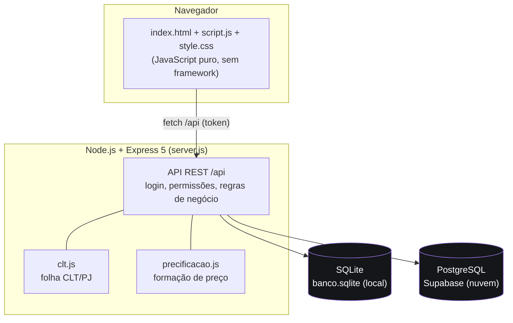

- **Front-end:** HTML, CSS e JavaScript puros, tema escuro e claro, responsivo, atualização automática a cada poucos segundos.
- **Back-end:** Node.js com Express 5, mais de 110 rotas em `/api`, sessão por token, senha com hash **scrypt**, permissões por tela checadas no servidor.
- **Banco:** SQLite no computador; PostgreSQL (Supabase) em produção, escolhido pela variável `DATABASE_URL`. As mesmas consultas funcionam nos dois.
- **Hospedagem:** pronto para Vercel (`api/index.js`) com Supabase.
- **Cálculos compartilhados:** `precificacao.js` roda no servidor e no navegador, então a prévia na tela e o valor gravado sempre batem.

<a name="s12"></a>
<p align="center"></p>

Cada usuário tem, para cada tela, **sem acesso**, **ver** ou **ver e editar** (`usuario_permissao`). O servidor confere a permissão em todas as rotas; esconder um botão na tela não basta.

| Perfil pronto | O que costuma acessar |
|---|---|
| **Administrador** | Tudo, inclusive usuários, log e parâmetros |
| **Gerente** | Tudo, menos usuários e acessos |
| **Vendedor(a)** | Dashboard, PDV, caixa, avisos, eventos e relatórios (ver) |
| **Caixa / Gerente de loja** | Caixa (editar), PDV, estoque e movimentações (ver), relatórios |
| **Estoquista** | Estoque, movimentações e eventos (editar), relatórios (ver) |
| **Financeiro / RH** | Contas a pagar e a receber, funcionários e fornecedores (editar); caixa, relatórios e custos (ver) |

A permissão **Custos e formação de preço** é separada do estoque: o vendedor consegue vender sem ver o custo e a margem de cada peça.

<a name="s13"></a>
<p align="center"></p>

**Requisitos:** Node.js 18 ou mais novo.

```bash
npm install
npm start
# abre em http://localhost:3000
```

O servidor cria ou atualiza o `banco.sqlite` sozinho na primeira vez. Para usar o **PostgreSQL/Supabase**, defina `DATABASE_URL` (veja `.env.example`); as migrações de `supabase/migrations` rodam na inicialização. Para criar o banco em **MySQL** do zero:

```bash
mysql -u root -p < banco_mysql.sql
```

<a name="s14"></a>
<p align="center"></p>

O link deste repositório é um site estático no **GitHub Pages**, sem servidor. Para o sistema funcionar mesmo assim:

1. O `server.js` do ERP foi empacotado para rodar **dentro do navegador** (esbuild), com versões leves do Express, do `crypto` e do `sqlite3`.
2. O banco é o **SQLite compilado para JavaScript** (sql.js), aberto a partir do banco da apresentação.
3. As chamadas a `/api` não saem da página: são atendidas por esse servidor local, com as **mesmas regras** do sistema real.
4. Depois de cada alteração, o banco é salvo no **localStorage** do navegador. Cada pessoa tem a própria cópia; **Restaurar dados** volta ao original.

<a name="s15"></a>
<p align="center"></p>

```text
Sistema completo (Difeecult.zip)
├── server.js            API Express, regras de negócio e criação do banco SQLite
├── script.js            front-end: telas, PDV, relatórios, tempo real
├── index.html           todas as telas e janelas
├── style.css            visual racing, tema escuro e claro, celular
├── precificacao.js      formação de preço (servidor e navegador)
├── clt.js               cálculo de holerite CLT e recibo PJ
├── banco_mysql.sql      o modelo inteiro em MySQL (34 tabelas)
├── supabase/migrations  migrações do PostgreSQL
├── payments/            integração de maquininhas (preparada)
├── api/index.js         entrada para a Vercel
└── test/                testes automatizados

Este repositório (demonstração no GitHub Pages)
├── index.html, script.js, style.css, precificacao.js
├── demo-servidor.js     o server.js empacotado para o navegador
├── demo-banco.js        o banco da apresentação
├── sql-asm.js           SQLite em JavaScript (sql.js)
├── demo.js              liga tudo e salva no localStorage
└── difeecult-readme-arquivos/                 imagens e GIFs deste README
```

<a name="s16"></a>
<p align="center"></p>

```bash
npm test
```

**214 testes automatizados** (`node --test`) cobrem vendas, brinde, cancelamento, pagamento diversificado, estoque e variações, categorias e tipos de evento, formação de preço, holerite CLT e PJ, contas, permissões por tela e relatórios. Também foram executados contra o PostgreSQL.

<a name="s17"></a>
<p align="center"></p>

- **PDV offline nos eventos:** vender sem internet e sincronizar depois.
- **Maquininha e NFC-e integradas:** pagamento confirmado direto e nota fiscal na venda.
- **Loja online no mesmo estoque:** e-commerce usando as mesmas tabelas.
- **Curva ABC e giro de estoque:** quais peças trazem 80% do faturamento.
- **Fornecedor na ficha de custo:** o aumento do tecido já recalcula o preço.
- **Conferência por QR code:** etiqueta com QR em cada peça para conferir o estoque pelo celular.

<p align="center"></p>

<p align="center"></p>
<p align="center"><sub>Projeto acadêmico de Engenharia de Software · UNICID · Modelagem de Banco de Dados</sub></p>
