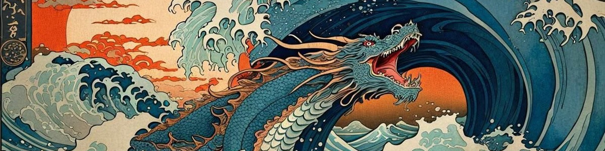

 

---

## 🌊 Sobre mim

Sou estudante de Engenharia de Software, interessado em Tecnologia da Informação, desenvolvimento de sistemas e Inteligência Artificial. Busco oportunidades para aplicar meus conhecimentos, aprender com desafios reais e contribuir com soluções tecnológicas úteis.

Gosto de projetos que unem software, infraestrutura de TI, organização de processos e resolução de problemas, do código ao hardware.

<!-- Opcional: coloque um GIF ukiyo-e seu em assets/ e descomente -->
<!--  -->

## ⛩️ Tecnologias e ferramentas

 

- **Linguagens e desenvolvimento:** Python, JavaScript, HTML, CSS, Java e C#.
- **Banco de dados:** SQL.
- **Hardware e prototipagem:** Arduino.
- **Versionamento:** Git e GitHub.

<b>🎴 Ver tudo em formato de badges</b>

 

## 🐉 Projetos

### 1. PACORA: Gestor de Turmas
Um sistema feito para gerir vários alunos sem dificuldade.

### 2. The Cure
Projeto desenvolvido com JavaScript, com amor de um fã da Olivia Rodrigo.

### 3. Pokédex
Projeto para registrar pesquisas dos pokémons.

### 4. Login Riot
Projeto de interface de login inspirado na Riot Games.

### 5. Eco em Foco: Meio Ambiente
Projeto de sustentabilidade e impacto social.

### 6. Agrotech
Projeto com sensores Arduino e interpretação de dados em Python, com foco em apoiar a agricultura familiar.

### 7. Star Wars: Jogo da Memória
Jogo da memória com personagens de Star Wars: A Guerra dos Clones.

## 📊 Dashboard de programação

 

 

 

 

> 💡 **Dica:** o card do WakaTime só aparece se você criar conta em [wakatime.com](https://wakatime.com), instalar o plugin no editor e deixar o perfil público. Sem isso, apague essa imagem.

## 🐍 Contribuições (snake)

<!-- Requer o workflow do Platane/snk: veja as instruções no final da conversa -->

---

**Obrigado por visitar meu perfil! 🌊**

