 

---

## Sobre mim 波

Sou estudante de Engenharia de Software, interessado em Tecnologia da Informação, desenvolvimento de sistemas e Inteligência Artificial. Gosto de aplicar o que aprendo em projetos reais, enfrentar desafios novos e criar soluções tecnológicas úteis.

Me interessam projetos que unem software, infraestrutura de TI, organização de processos e resolução de problemas, do código ao hardware.

> 波 (nami): a onda. Cada projeto é uma onda diferente; o importante é aprender a atravessá-la.

## Tecnologias e ferramentas 海

 

- **Linguagens e desenvolvimento:** Python, JavaScript, HTML, CSS, Java e C#.
- **Banco de dados:** SQL.
- **Hardware e prototipagem:** Arduino.
- **Versionamento:** Git e GitHub.

<b>Ver tudo em formato de badges</b>

 

## Projetos 潮

### 1. PACORA: Gestor de Turmas
Um sistema feito para gerir vários alunos sem dificuldade.

### 2. The Cure
Projeto desenvolvido com JavaScript, com amor de um fã da Olivia Rodrigo.

### 3. Pokédex
Projeto para registrar pesquisas dos pokémons.

### 4. Login Riot
Projeto de interface de login inspirado na Riot Games.

### 5. Eco em Foco: Meio Ambiente
Projeto de sustentabilidade e impacto social.

### 6. Agrotech
Projeto com sensores Arduino e interpretação de dados em Python, com foco em apoiar a agricultura familiar.

### 7. Star Wars: Jogo da Memória
Jogo da memória com personagens de Star Wars: A Guerra dos Clones.

## Dashboard de programação

  

 

---

**Obrigado por visitar meu perfil.**

