<!--
  Tema: 浮世絵 (ukiyo-e) azul · mar, carpas e sakura.
  As imagens dentro de <a> sem href não abrem em nova aba quando clicadas.
  Visuais gerados por scripts/gerar_visuais.py, scripts/gerar_lago.py e scripts/peixe_commits.py.
-->

<a></a>

<a href="https://portolio-c-kaue-alves-da-silva.netlify.app/"></a>
&nbsp;
<a href="https://www.linkedin.com/in/cicerokauealves/"></a>

 

<a></a>

<a></a>

Sou estudante de Engenharia de Software, com foco em **Análise de Dados** e interesse em Tecnologia da Informação, desenvolvimento de sistemas e Inteligência Artificial. Gosto de aplicar o que aprendo em projetos reais, enfrentar desafios novos e criar soluções úteis, unindo software, infraestrutura e organização de processos, do código ao hardware.

> **波 (nami): a onda.** Cada projeto é uma onda diferente; o importante é aprender a atravessá-la.

<a></a>

<a></a>

| 🌊 Área | Ferramentas |
|---|---|
| Linguagens e desenvolvimento | Python · JavaScript · HTML · CSS · Java · C# |
| Dados | SQL · MySQL · análise de dados com Python |
| Hardware e prototipagem | Arduino |
| Versionamento | Git · GitHub |

<a></a>

<a></a>

<a href="https://github.com/callmekaue/modelagem-difeecult"></a>

<a href="https://github.com/callmekaue/class-management"></a>

<a href="https://github.com/callmekaue/the-cure-javascript"></a>

<a href="https://github.com/callmekaue/pokedex"></a>

<a href="https://github.com/callmekaue/login_riot"></a>

<a href="https://github.com/callmekaue/AGROTECH"></a>

<a href="https://github.com/callmekaue/starwars-game"></a>

<a></a>

<a></a>

<a></a>

> **登龍門 (tōryūmon): o Portão do Dragão.** Diz a lenda que a carpa que vence a correnteza e salta o portão vira dragão. Cada commit é uma braçada: o koi acima evolui sozinho conforme eu programo.

<a></a>

<a></a>
